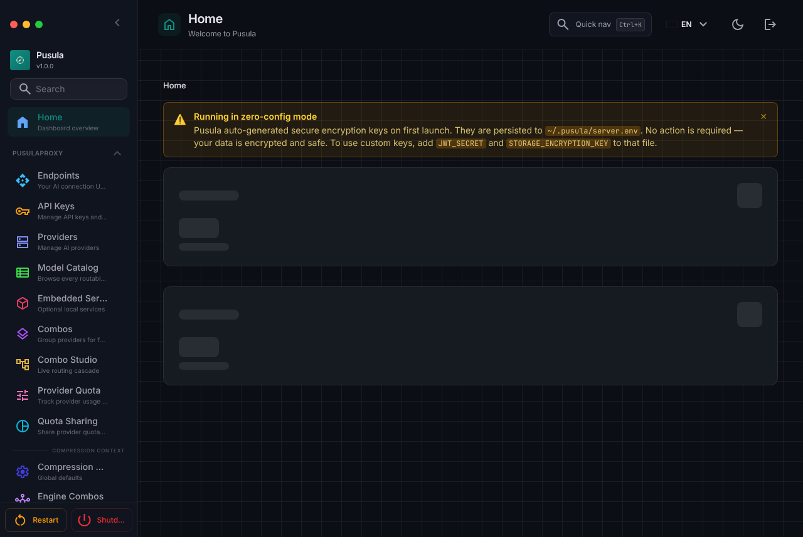

<div align="center">



<br/>
<br/>

# 🧭 Pusula — The Free AI Gateway



</div>

<div align="center">

## 💰 ~1.62B Free Tokens / Month

</div>

> Stacking free tiers by hand is painful — dozens of SDKs, dozens of rate limits, and no idea how much you actually have. Pusula catalogs **467 free-tier entries across 34 recurring pool keys** and computes the token headline from the **17 pools with a published positive monthly budget plus five per-model Groq caps**, deduplicated by shared pool. Quotas that only open after a regional identity check (today: ModelScope) are shown apart, +~6M behind regional identity verification, and never summed into the headline. The result stays visible on the dashboard (`/dashboard/free-tiers`).


> Animated summary of the live `/dashboard/free-tiers` page. Full methodology (pool dedupe, credit tiers, provider terms): **[docs/reference/FREE_TIERS.md](docs/reference/FREE_TIERS.md)**.
>
> <sub>These figures come straight from the free-tier catalog (last curated 2026-10-19) and **move both ways** — a provider ends a free tier and the number drops; a new one lands and it climbs. We publish what the catalog actually computes, never a rounded-up best case.</sub>

<br/>

<div align="center">

<h3>

⭐ Star the repo if PUSULA helped you save money and make your work easier.

</h3>

[](https://github.com/Ferhat-Yasinoglu/pusula)

### 💬 Questions & support

[](https://github.com/Ferhat-Yasinoglu/pusula/issues)

**Bugs, feature requests & questions → [open an issue](https://github.com/Ferhat-Yasinoglu/pusula/issues) · What's planned → [ROADMAP.md](ROADMAP.md)**

<br/>

## 🧩 Available

[](https://www.npmjs.com/package/pusula)

[](https://github.com/Ferhat-Yasinoglu/pusula/pkgs/container/pusula)
[](LICENSE)

<table>
  <tr>
    <td align="right"><b>🚀 Start</b></td>
    <td align="center"><a href="#-quick-start">🚀 Quick Start</a></td>
    <td align="center"><a href="#-more-install-methods--docker-bun-source-pnpm-nix-podman">📦 Install</a></td>
    <td align="center"><a href="#-install-connect-a-provider-route">🆓 First request</a></td>
  </tr>
  <tr>
    <td align="right"><b>💡 Learn</b></td>
    <td align="center"><a href="#-the-promise">💥 The Promise</a></td>
    <td align="center"><a href="#-why-pusula">🤔 Why Pusula</a></td>
    <td align="center"><a href="#-what-sets-pusula-apart">🏆 What Sets Apart</a></td>
  </tr>
  <tr>
    <td align="right"><b>⚙️ Features</b></td>
    <td align="center"><a href="#-combos--the-flagship">🎯 Combos</a></td>
    <td align="center"><a href="#-375-ai-providers--153-catalog-marked-free">🌐 Providers</a></td>
    <td align="center"><a href="#-full-cli--a2a--mcp">🔌 CLI &amp; MCP</a></td>
  </tr>
  <tr>
    <td align="right"></td>
    <td align="center"><a href="#%EF%B8%8F-save-1595-tokens--automatically">🗜️ Compression</a></td>
    <td align="center"><a href="#%EF%B8%8F-where-pusula-runs--anywhere">🖥️ Where It Runs</a></td>
    <td align="center"><a href="#-private--local-first">🔒 Private</a></td>
  </tr>
  <tr>
    <td align="right"><b>👀 See it</b></td>
    <td align="center"><a href="#-compatible-clis--coding-agents">🤖 Compatible CLIs</a></td>
    <td align="center"><a href="#-community--help">💬 Community &amp; Help</a></td>
  </tr>
  <tr>
    <td align="right"><b>📦 Project</b></td>
    <td align="center"><a href="#%EF%B8%8F-tech-stack">🛠️ Tech Stack</a></td>
    <td align="center"><a href="#-documentation">📖 Docs</a></td>
    <td align="center"><a href="#-contributing">👥 Contributing</a></td>
  </tr>
</table>

</div>

<div align="center">
  <b>🌐 In 4 languages</b>
  <br/><br/>
  <a href="README.md"></a>
  <a href="docs/i18n/tr/README.md"></a>
  <a href="docs/i18n/de/README.md"></a>
  <a href="docs/i18n/fa/README.md"></a>
</div>

<br/>
<br/>

<div align="center">

## 🆓 Install, connect a provider, route

</div>



```bash
# After connecting at least one provider (Dashboard → Providers), `auto` routes across it:
curl http://localhost:20128/v1/chat/completions \
  -H "Content-Type: application/json" \
  -d '{"model":"auto","messages":[{"role":"user","content":"Hello!"}]}'
```

<sub>Prefer a specific backend? Call it directly as `<alias>/<model>` (aliases are listed in [docs/reference/PROVIDER_REFERENCE.md](docs/reference/PROVIDER_REFERENCE.md)). Then graduate to `auto` and let Pusula pick.</sub>

<sub>📦 Copy-paste quickstart scripts for **Python, Node.js, PHP, and cURL** → [`examples/quickstart/`](examples/quickstart/)</sub>

<br/>

<div align="center">

# 💥 The Promise

</div>


<br/>
<br/>

<div align="center">

# 🤔 Why Pusula?

</div>


<div align="center">



</div>

<br/>

<div align="center">

## 🎯 Combos — The Flagship

</div>



> A **combo** is a chain of models Pusula routes across **automatically**. If quota runs out, a provider fails, or costs spike, the combo can move to the next eligible healthy model. 🛡️

### ⚡ Zero-config — just use `auto`

No combo to create. Set your model to `auto` (or a variant) and Pusula builds a virtual combo from your connected providers, scored live:

<table>
  <tr><th align="left">Model ID</th><th align="left">What it optimizes for</th></tr>
  <tr><td align="left" nowrap><code>auto</code></td><td align="left">🎯 Balanced default (LKGP — sticks to your last good provider)</td></tr>
  <tr><td align="left" nowrap><code>auto/coding</code></td><td align="left">🧑‍💻 Quality-first weights for code generation</td></tr>
  <tr><td align="left" nowrap><code>auto/fast</code></td><td align="left">⚡ Lowest latency first</td></tr>
  <tr><td align="left" nowrap><code>auto/cheap</code></td><td align="left">💰 Cheapest per token first</td></tr>
  <tr><td align="left" nowrap><code>auto/offline</code></td><td align="left">🔋 Most quota / rate-limit headroom first</td></tr>
  <tr><td align="left" nowrap><code>auto/smart</code></td><td align="left">🔭 Quality-first + 10% exploration to discover better models</td></tr>
  <tr><td align="left" nowrap><code>auto/lkgp</code></td><td align="left">📌 Explicit last-known-good-provider stickiness</td></tr>
  <tr><td align="left" nowrap><code>auto/chaos</code></td><td align="left">🧪 Fans the same prompt out in parallel to the most stable connected models and streams every answer back (no judge)</td></tr>
</table>

##

### 🔀 Or build your own — 20 routing strategies

All **20** strategies — mix & match per combo step:

<table>
  <tr>
    <th>#</th>
    <th align="left">Strategy</th>
    <th align="left">What it does</th>
  </tr>
  <tr>
    <td align="center">1</td>
    <td nowrap><code>priority</code></td>
    <td>First-target ordered list — drain each before the next 🥇</td>
  </tr>
  <tr>
    <td align="center">2</td>
    <td nowrap><code>fill-first</code></td>
    <td>Fill each target's quota fully before moving on</td>
  </tr>
  <tr>
    <td align="center">3</td>
    <td nowrap><code>weighted</code></td>
    <td>Weighted random by per-target weight</td>
  </tr>
  <tr>
    <td align="center">4</td>
    <td nowrap><code>round-robin</code></td>
    <td>Cycle through targets in order</td>
  </tr>
  <tr>
    <td align="center">5</td>
    <td nowrap><code>p2c</code></td>
    <td>Power-of-two-choices random load balancing</td>
  </tr>
  <tr>
    <td align="center">6</td>
    <td nowrap><code>least-used</code></td>
    <td>Pick the target with the lowest current load</td>
  </tr>
  <tr>
    <td align="center">7</td>
    <td nowrap><code>random</code></td>
    <td>Uniform random pick (deduplicated)</td>
  </tr>
  <tr>
    <td align="center">8</td>
    <td nowrap><code>strict-random</code></td>
    <td>Shuffle deck — uses each target once before reshuffling 🎲</td>
  </tr>
  <tr>
    <td align="center">9</td>
    <td nowrap><code>cost-optimized</code></td>
    <td>Minimize $ per request from live catalog pricing 💸</td>
  </tr>
  <tr>
    <td align="center">10</td>
    <td nowrap><code>headroom</code></td>
    <td>Pick the target with the most remaining quota</td>
  </tr>
  <tr>
    <td align="center">11</td>
    <td nowrap><code>quota-weighted</code></td>
    <td>Skip exhausted accounts, then pick among the rest in proportion to leftover quota ÷ in-flight load; existing conversations stay pinned</td>
  </tr>
  <tr>
    <td align="center">12</td>
    <td nowrap><code>reset-window</code></td>
    <td>Prefer the target whose quota window resets soonest</td>
  </tr>
  <tr>
    <td align="center">13</td>
    <td nowrap><code>reset-aware</code></td>
    <td>Rank by quota reset time — short windows first 📊</td>
  </tr>
  <tr>
    <td align="center">14</td>
    <td nowrap><code>context-relay</code></td>
    <td>Hand off context across targets for long conversations 🧠</td>
  </tr>
  <tr>
    <td align="center">15</td>
    <td nowrap><code>context-optimized</code></td>
    <td>Pick the best fit for the current context size</td>
  </tr>
  <tr>
    <td align="center">16</td>
    <td nowrap><code>cache-optimized</code></td>
    <td>Pin each reusable prompt prefix to the same account — maximize prompt-cache hits 🎯</td>
  </tr>
  <tr>
    <td align="center">17</td>
    <td nowrap><code>lkgp</code></td>
    <td>Last-Known-Good Path — pins to the last successful provider, then falls back to rules</td>
  </tr>
  <tr>
    <td align="center">18</td>
    <td nowrap><code>auto</code></td>
    <td>16-factor live scoring across every connection 🤖</td>
  </tr>
  <tr>
    <td align="center">19</td>
    <td nowrap><code>fusion</code></td>
    <td>Fan out to a panel of models + a judge synthesizes one answer 🧬</td>
  </tr>
  <tr>
    <td align="center">20</td>
    <td nowrap><code>pipeline</code></td>
    <td>Chain steps — each target's output feeds the next one 🔗</td>
  </tr>
</table>

<sub>The Auto-Combo engine scores every candidate on **16 factors** (health, quota, cost, latency, task fit, quality, session availability…) — see [`docs/routing/AUTO-COMBO.md`](docs/routing/AUTO-COMBO.md).</sub>

##

### 🧱 Resilience is built in (3 independent layers)


<sub>📖 [Auto-Combo Engine](docs/routing/AUTO-COMBO.md) · [Resilience Guide](docs/architecture/RESILIENCE_GUIDE.md)</sub>

<br/>

<div align="center">

## 🏆 What Sets Pusula Apart

</div>


<sub>📊 Full methodology &amp; per-feature detail vs 9router, OpenRouter, CLIProxyAPI &amp; LiteLLM → [`docs/comparison/PUSULA_VS_ALTERNATIVES.md`](docs/comparison/PUSULA_VS_ALTERNATIVES.md)</sub>

<br/>

<div align="center">

## 🤖 Compatible CLIs & Coding Agents

> One config — `http://localhost:20128/v1` — and **every** AI IDE or CLI runs on free & low-cost models.

<div align="center">
<table>
  <tr>
    <td align="center" width="76"><a href="https://github.com/anthropics/claude-code"><br/><sub><b>Claude Code</b></sub><br/><sub>                           </sub></a></td>
    <td align="center" width="76"><a href="https://github.com/openai/codex"><br/><sub><b>Codex CLI</b></sub><br/><sub>                           </sub></a></td>
    <td align="center" width="76"><picture><source media="(prefers-color-scheme:dark)" srcset="https://cdn.jsdelivr.net/npm/@lobehub/icons-static-png@1.91.0/dark/cline.png"/></picture><br/><sub><b>Cline</b></sub><br/><sub>                           </sub></td>
    <td align="center" width="76"><a href="https://github.com/Kilo-Org/kilocode"><br/><sub><b>Kilo Code</b></sub><br/><sub>                           </sub></a></td>
    <td align="center" width="76"><a href="https://docs.roocode.com/"><br/><sub><b>Roo Code</b></sub><br/><sub>                           </sub></a></td>
    <td align="center" width="76"><br/><sub><b>Continue</b></sub><br/><sub>                           </sub></td>
  </tr>
  <tr>
    <td align="center" width="76"><br/><sub><b>Aider</b></sub><br/><sub>                           </sub></td>
    <td align="center" width="76"><br/><sub><b>ForgeCode</b></sub><br/><sub>                           </sub></td>
    <td align="center" width="76"><br/><sub><b>jcode</b></sub><br/><sub>                           </sub></td>
    <td align="center" width="76"><br/><sub><b>DeepSeek TUI</b></sub><br/><sub>                           </sub></td>
    <td align="center" width="76"><br/><sub><b>CodeWhale</b></sub><br/><sub>                           </sub></td>
    <td align="center" width="76"><a href="https://github.com/anomalyco/opencode"><br/><sub><b>OpenCode</b></sub><br/><sub>                           </sub></a></td>
  </tr>
  <tr>
    <td align="center" width="76"><br/><sub><b>Factory Droid</b></sub><br/><sub>                           </sub></td>
    <td align="center" width="76"><br/><sub><b>Copilot CLI</b></sub><br/><sub>                           </sub></td>
    <td align="center" width="76"><br/><sub><b>Cursor CLI</b></sub><br/><sub>                           </sub></td>
    <td align="center" width="76"><br/><sub><b>Smelt</b></sub><br/><sub>                           </sub></td>
    <td align="center" width="76"><br/><sub><b>Pi</b></sub><br/><sub>                           </sub></td>
    <td align="center" width="76"><br/><sub><b>Grok Build</b></sub><br/><sub>                           </sub></td>
  </tr>
  <tr>
    <td align="center" width="76"><picture><source media="(prefers-color-scheme:dark)" srcset="https://cdn.jsdelivr.net/npm/@lobehub/icons-static-png@1.91.0/dark/nousresearch.png"/></picture><br/><sub><b>Hermes Agent</b></sub><br/><sub>                           </sub></td>
    <td align="center" width="76"><br/><sub><b>OpenClaw</b></sub><br/><sub>                           </sub></td>
    <td align="center" width="76"><picture><source media="(prefers-color-scheme:dark)" srcset="https://cdn.jsdelivr.net/npm/@lobehub/icons-static-png@1.91.0/dark/goose.png"/></picture><br/><sub><b>Goose</b></sub><br/><sub>                           </sub></td>
    <td align="center" width="76"><br/><sub><b>Open Interpreter</b></sub><br/><sub>                           </sub></td>
    <td align="center" width="76"><br/><sub><b>Warp AI</b></sub><br/><sub>                           </sub></td>
  </tr>
</table>
</div>

<div align="center">
<b>＋ also works with</b> · Agent Deck · Crush · Zed · Qwen Code · Oh My Pi · Letta CLI · Prime Agent · 5dive · Kiro / Antigravity (via MITM) · <b>any OpenAI-compatible tool</b>
</div>

<sub>📖 Per-tool setup for all 37 tools (27 CLI Code's + 10 CLI Agents) → [`docs/reference/CLI-TOOLS.md`](docs/reference/CLI-TOOLS.md) · 🧩 OpenCode plugin → [`@pusula/opencode-plugin`](@pusula/opencode-plugin/README.md) (bundled; `pusula setup opencode`)</sub>

</div>

<br/>

**Launch any supported CLI through Pusula in one command** — no config files written,
credentials injected per process, Qwen/Gemini get a throwaway isolated home:

```bash
pusula run claude   --model openai/gpt-5.4          # Claude Code
pusula run codex    --model glm/glm-5.2             # OpenAI Codex CLI
pusula run aider    --model glm/glm-5.2 -- --message "reply OK"
pusula run goose    --model glm/glm-5.2
pusula run opencode --model glm/glm-5.2 -- run "reply OK"
pusula run qwen     --model glm/glm-5.2 -- -p "reply OK"
pusula run gemini   --model glm/glm-5.2 -- --skip-trust -p "reply OK"

# Or pick provider+model interactively and write the tool's own config:
pusula configure codex          # also: claude opencode qwen aider goose gemini cline continue kilo
```

Every command honors the active remote context (`pusula connect <host>`), `--dry-run`
previews the exact env/args without executing, and `--api-key-env NAME` keeps secrets out
of your shell history. → [CLI Integrations](docs/guides/CLI-INTEGRATIONS.md)

<br/>

<div align="center">

## 🌐 375 AI Providers — 153 Catalog-Marked Free

</div>

> **375 registered providers** across the canonical chat, media, search, local, cloud-agent and system collections, including **153 carrying `hasFree: true` discovery metadata**. The chat model registry covers **239 providers with static models / 3,059 distinct provider-model pairs / 1,476 distinct model IDs**; the separate free-budget catalog has **467 per-model rows**, **34 recurring pools** and **51 recurring/keyless free-forever providers**. These are different denominators by design; definitions and pool-deduped calculations live in the [Provider Reference](docs/reference/PROVIDER_REFERENCE.md) and [Free Tiers](docs/reference/FREE_TIERS.md).

<div align="center">

### 🏢 Every major lab — through one endpoint

<table>
  <tr>
    <td align="center" width="80"><picture><source media="(prefers-color-scheme:dark)" srcset="https://cdn.jsdelivr.net/npm/@lobehub/icons-static-png@1.91.0/dark/openai.png"/></picture><br/><sub>OpenAI</sub><br/><sub>                           </sub></td>
    <td align="center" width="80"><br/><sub>Anthropic</sub><br/><sub>                           </sub></td>
    <td align="center" width="80"><br/><sub>Gemini</sub><br/><sub>                           </sub></td>
    <td align="center" width="80"><picture><source media="(prefers-color-scheme:dark)" srcset="https://cdn.jsdelivr.net/npm/@lobehub/icons-static-png@1.91.0/dark/grok.png"/></picture><br/><sub>xAI Grok</sub><br/><sub>                           </sub></td>
    <td align="center" width="80"><br/><sub>DeepSeek</sub><br/><sub>                           </sub></td>
    <td align="center" width="80"><br/><sub>Mistral</sub><br/><sub>                           </sub></td>
  </tr>
  <tr>
    <td align="center" width="80"><br/><sub>Qwen</sub><br/><sub>                           </sub></td>
    <td align="center" width="80"><br/><sub>Meta Llama</sub><br/><sub>                           </sub></td>
    <td align="center" width="80"><picture><source media="(prefers-color-scheme:dark)" srcset="https://cdn.jsdelivr.net/npm/@lobehub/icons-static-png@1.91.0/dark/groq.png"/></picture><br/><sub>Groq</sub><br/><sub>                           </sub></td>
    <td align="center" width="80"><br/><sub>NVIDIA</sub><br/><sub>                           </sub></td>
    <td align="center" width="80"><br/><sub>MiniMax</sub><br/><sub>                           </sub></td>
    <td align="center" width="80"><br/><sub>Cohere</sub><br/><sub>                           </sub></td>
  </tr>
  <tr>
    <td align="center" width="80"><br/><sub>Perplexity</sub><br/><sub>                           </sub></td>
    <td align="center" width="80"><br/><sub>HuggingFace</sub><br/><sub>                           </sub></td>
    <td align="center" width="80"><br/><sub>Together</sub><br/><sub>                           </sub></td>
    <td align="center" width="80"><br/><sub>Fireworks</sub><br/><sub>                           </sub></td>
    <td align="center" width="80"><br/><sub>Cloudflare</sub><br/><sub>                           </sub></td>
    <td align="center" width="80"><br/><sub>Baidu</sub><br/><sub>                           </sub></td>
  </tr>
</table>

<sub>…and 350+ more — every icon resolves live from the dashboard's provider catalog. 📖 [Provider Reference](docs/reference/PROVIDER_REFERENCE.md)</sub>

<br/>

### 🆓 Free Forever — $0, no card

<table>
  <tr>
    <td align="center" width="150"><br/><b>OpenCode Zen</b><br/><sub>DeepSeek V4, Nemotron 3<br/>No token cap</sub></td>
    <td align="center" width="150"><br/><b>Kilo Code</b><br/><sub>Auto-router, Tencent Hy3<br/>Free forever</sub></td>
    <td align="center" width="150"><br/><b>Requesty</b><br/><sub>GPT-OSS 120B, Nemotron<br/>Free forever</sub></td>
    <td align="center" width="150"><br/><b>Z.AI GLM</b><br/><sub>GLM-4.7 / 4.5-Flash<br/>Free forever</sub></td>
    <td align="center" width="150"><br/><b>Baidu ERNIE</b><br/><sub>ERNIE 4.0<br/>Free forever</sub></td>
  </tr>
  <tr>
    <td align="center" width="150"><br/><b>Pollinations</b><br/><sub>GPT, DeepSeek, Grok, Mistral<br/>No key needed</sub></td>
    <td align="center" width="150"><br/><b>Cloudflare AI</b><br/><sub>Llama 3.3, Qwen, GLM, Kimi<br/>10K neurons/day</sub></td>
    <td align="center" width="150"><br/><b>NVIDIA NIM</b><br/><sub>Kimi, GLM, DeepSeek<br/>~40 RPM free</sub></td>
    <td align="center" width="150"><br/><b>OpenRouter</b><br/><sub>:free models<br/>+$10 → higher RPM</sub></td>
  </tr>
</table>

📖 Full machine-readable catalog → [`docs/reference/PROVIDER_REFERENCE.md`](docs/reference/PROVIDER_REFERENCE.md)

<br/>
</div>

<div align="center">

## 🖥️ Where Pusula Runs — Anywhere

</div>

> Same app, your machine, your rules. From a global npm install to **your phone** via Termux.

<table>
  <tr><th align="left">Platform</th><th align="left">Install</th><th align="left">Highlights</th></tr>
  <tr><td align="left" nowrap>📦 <b>npm (global)</b></td><td align="left" nowrap><code>npm install -g pusula</code></td><td align="left">One command, any OS</td></tr>
  <tr><td align="left" nowrap>🐳 <b>Docker</b></td><td align="left" nowrap><code>docker run … ghcr.io/ferhat-yasinoglu/pusula</code></td><td align="left">Multi-arch <b>AMD64 + ARM64</b></td></tr>
  <tr><td align="left" nowrap>🖥️ <b>Desktop (Electron)</b></td><td align="left" nowrap><code>npm run electron:build</code></td><td align="left">Native window + system tray — <b>Windows / macOS / Linux</b></td></tr>
  <tr><td align="left" nowrap>💪 <b>ARM</b></td><td align="left" nowrap>native <code>arm64</code></td><td align="left">Raspberry Pi, ARM servers, Apple Silicon</td></tr>
  <tr><td align="left" nowrap>📱 <b>Android (Termux)</b></td><td align="left" nowrap><code>pkg install nodejs && npx -y pusula</code></td><td align="left">Runs <b>on your phone</b>, 24/7, no root</td></tr>
  <tr><td align="left" nowrap>📲 <b>PWA</b></td><td align="left" nowrap>"Add to Home Screen"</td><td align="left">Standalone app window, offline page, installable from the browser</td></tr>
  <tr><td align="left" nowrap>🧩 <b>OpenCode plugin</b></td><td align="left" nowrap><code>pusula setup opencode</code></td><td align="left">Installs the bundled <code>@pusula/opencode-plugin</code> into OpenCode</td></tr>
  <tr><td align="left" nowrap>🛠️ <b>From source</b></td><td align="left" nowrap><code>npm install && npm run dev</code></td><td align="left">Hack on it, contribute</td></tr>
</table>

<sub>📖 [Docker Guide](docs/guides/DOCKER_GUIDE.md) · [Desktop](electron/README.md) · [Termux](docs/guides/TERMUX_GUIDE.md) · [PWA](docs/guides/PWA_GUIDE.md) · [OpenCode](docs/frameworks/OPENCODE.md)</sub>

<br/>

<div align="center">

## 🔒 Private & Local-First

</div>


<sub>📖 [Authorization](docs/architecture/AUTHZ_GUIDE.md) · [Guardrails](docs/security/GUARDRAILS.md) · [Compliance](docs/security/COMPLIANCE.md)</sub>

<br/>

<div align="center">

## 🔌 Full CLI + A2A & MCP

</div>

> Beyond the server, Pusula is a **full command-line cockpit** with **80+ commands**, plus open agent protocols so an AI agent can drive it **on its own**.

### ⌨️ A real CLI (not just `start`)

```bash
pusula               # serve gateway + dashboard (port 20128)
pusula repl          # interactive TUI chat (slash: /model /combo /skill /memory)
pusula setup         # guided first-run wizard
pusula doctor        # diagnose config, DB, ports, Node runtime, native deps
```

### 🛰️ Remote mode — run the CLI here, Pusula on a VPS

Pusula on a server? Drive it from your laptop with the **same CLI**. Log in once
with a scoped access token; every command then targets the remote.

```bash
pusula connect 192.168.0.15            # password → scoped token, saved as a context
pusula models                         # ← runs against the REMOTE server
pusula configure codex                 # ← picks a remote model, writes a local Codex profile
pusula tokens create --name ci --scope read   # mint narrower tokens for other machines
pusula contexts use default            # ← switch back to the local server
```

Tokens are scoped `read` / `write` / `admin`; process-spawning routes stay loopback-only.
<sub>📖 [Remote Mode](docs/guides/REMOTE-MODE.md)</sub>

<div align="left">



</div>

### 🤝 Connect an agent — and it controls Pusula itself

Expose Pusula over **MCP**, **A2A**, a **REST API**, **webhooks** or a **remote CLI** — any capable agent (or your own code) gets the keys to the whole gateway: routing, providers, combos, cache, compression, memory — autonomously. HTTP endpoints below are served under `http://localhost:20128`.

<table>
  <tr><th align="left">Interface</th><th align="left">Endpoint / command</th><th align="left">Use it for</th></tr>
  <tr><td align="left" nowrap>🧰 <b>MCP (stdio)</b></td><td align="left" nowrap><code>pusula --mcp</code></td><td align="left">Plug into Claude Desktop, Cursor, any MCP client</td></tr>
  <tr><td align="left" nowrap>🌊 <b>MCP (HTTP)</b></td><td align="left" nowrap><code>/api/mcp/stream</code></td><td align="left">Remote MCP — <b>110 tools</b>, 33 scopes (enforcement opt-in), full audit trail</td></tr>
  <tr><td align="left" nowrap>📡 <b>MCP (SSE)</b></td><td align="left" nowrap><code>/api/mcp/sse</code></td><td align="left">Streaming MCP transport</td></tr>
  <tr><td align="left" nowrap>🤝 <b>A2A</b></td><td align="left" nowrap><code>/.well-known/agent.json</code></td><td align="left">Agent-to-agent, <b>JSON-RPC 2.0</b> + SSE, 6 skills</td></tr>
  <tr><td align="left" nowrap>🌐 <b>REST API</b></td><td align="left" nowrap><code>/v1/*</code></td><td align="left">OpenAI-compatible — chat, embeddings, images, audio, OCR</td></tr>
  <tr><td align="left" nowrap>🔔 <b>Webhooks</b></td><td align="left" nowrap><code>/api/webhooks</code></td><td align="left">Push request / quota events to chat apps or any URL</td></tr>
  <tr><td align="left" nowrap>🛰️ <b>Remote CLI</b></td><td align="left" nowrap><code>pusula connect <host></code></td><td align="left">Drive a remote instance with scoped access tokens</td></tr>
</table>

```bash
# Give Claude Code the full Pusula toolset over MCP:
pusula mcp enable --transport streamable-http
claude mcp add --transport http pusula http://localhost:20128/api/mcp/stream --header "Authorization: Bearer <api-key-with-management-access>"
```

<sub>📖 [MCP Server](docs/frameworks/MCP-SERVER.md) · [A2A Server](docs/frameworks/A2A-SERVER.md) · [Agent Protocols](docs/frameworks/AGENT_PROTOCOLS_GUIDE.md)</sub>

<br/>

<div align="center">

## 🗜️ Save 15–95% Tokens — Automatically

</div>

### 📖 How it works — pipeline, architecture & savings math



Default stacked combo runs `RTK → Caveman`. When both act on the same tool/context payload, savings compound:

```txt
combined = 1 − (1 − RTK) × (1 − Caveman_input)
average  = 1 − (1 − 0.80) × (1 − 0.46) = 89.2%
range    = 78.4 – 94.6%
```

Code blocks, URLs, JSON and structured data are **always protected** by the preservation engine.

> **Why use many tokens when few tokens do the trick?** Every request passes through Pusula's compression pipeline **transparently** — no client changes. It's now a **stack of 12 composable engines** that run in order and mix & match per routing combo — building on ideas from [RTK](https://github.com/rtk-ai/rtk), [Caveman](https://github.com/JuliusBrussee/caveman), [LLMLingua-2](https://github.com/microsoft/LLMLingua), and [Troglodita](https://github.com/leninejunior/troglodita) (PT-BR).

### 🧱 The 12-engine stack

Engines run in pipeline order; each is independently toggleable and configurable per combo:

<table>
  <tr><th align="center">#</th><th align="left">Engine</th><th align="left">What it does</th></tr>
  <tr><td align="center" nowrap>1</td><td align="left" nowrap><b>Session-Dedup</b></td><td align="left">Drops content repeated across turns (content-addressed, cross-turn)</td></tr>
  <tr><td align="center" nowrap>2</td><td align="left" nowrap><b>CCR</b></td><td align="left">Archives large blocks behind retrieve markers, fetched on demand</td></tr>
  <tr><td align="center" nowrap>3</td><td align="left" nowrap><b>Lite</b></td><td align="left">Whitespace + image-URL trimming (latency-light baseline)</td></tr>
  <tr><td align="center" nowrap>4</td><td align="left" nowrap><b>RTK</b></td><td align="left">Smart tool-result filtering, dedup & truncation (command-aware)</td></tr>
  <tr><td align="center" nowrap>5</td><td align="left" nowrap><b>Responses Tool Output</b></td><td align="left">Lossless-first JSON + bounded diagnostic compression for shell/patch/search/build outputs (Responses API)</td></tr>
  <tr><td align="center" nowrap>6</td><td align="left" nowrap><b>Headroom</b></td><td align="left">Lossless tabular compaction of JSON arrays (~30%) via a vendored <b>GCF</b> codec</td></tr>
  <tr><td align="center" nowrap>7</td><td align="left" nowrap><b>Relevance</b></td><td align="left">Extractive sentence scoring against the last user query</td></tr>
  <tr><td align="center" nowrap>8</td><td align="left" nowrap><b>Caveman</b></td><td align="left">Rule-based prose compression (~65–75% on output)</td></tr>
  <tr><td align="center" nowrap>9</td><td align="left" nowrap><b>Aggressive</b></td><td align="left">Summarization + progressive aging of old turns</td></tr>
  <tr><td align="center" nowrap>10</td><td align="left" nowrap><b>LLMLingua-2</b></td><td align="left">ML semantic pruning via a TinyBERT ONNX model (BERT-base optional) — code-safe, async</td></tr>
  <tr><td align="center" nowrap>11</td><td align="left" nowrap><b>Ultra</b></td><td align="left">Heuristic token pruning with an optional small-model (SLM) tier</td></tr>
  <tr><td align="center" nowrap>12</td><td align="left" nowrap><b>OmniGlyph</b></td><td align="left">Experimental context-as-image encoding for measured Claude Fable 5 on the direct Anthropic wire; GPT 5.6 transformers remain fail-closed pending provider receipts. Four compression profiles (aggressive default, balanced, coding-safe, passthrough) (most aggressive; opt-in)</td></tr>
</table>

Code blocks, URLs and structured data are **always preserved** byte-perfect. **One-click presets** combine the engines:

<table>
  <tr><th align="left">Mode</th><th align="left">Savings</th><th align="left">Best for</th></tr>
  <tr><td align="left" nowrap>🪶 <b>Lite</b></td><td align="left" nowrap>~15%</td><td align="left">Always-on safe default</td></tr>
  <tr><td align="left" nowrap>🪨 <b>Standard (Caveman)</b></td><td align="left" nowrap>~30%</td><td align="left">Daily coding</td></tr>
  <tr><td align="left" nowrap>⚡ <b>Aggressive</b></td><td align="left" nowrap>~50%</td><td align="left">Long tool-heavy sessions</td></tr>
  <tr><td align="left" nowrap>🔥 <b>Ultra</b></td><td align="left" nowrap>~75%</td><td align="left">Maximum savings</td></tr>
  <tr><td align="left" nowrap>🧰 <b>RTK</b></td><td align="left" nowrap>60–90%</td><td align="left">Shell/test/build/git output</td></tr>
  <tr><td align="left" nowrap>🔗 <b>Stacked (RTK → Caveman)</b></td><td align="left" nowrap><b>78–95%</b></td><td align="left">Mixed prompts + tool logs</td></tr>
</table>

**Real example — Standard mode:**

> **Before (69 tokens):** _"The reason your React component is re-rendering is likely because you're creating a new object reference on each render cycle. When you pass an inline object as a prop, React's shallow comparison sees it as a different object every time, which triggers a re-render. I would recommend using useMemo to memoize the object."_
>
> **After (19 tokens):** _"New object ref each render. Inline object prop = new ref = re-render. Wrap in useMemo."_
>
> **Same answer. 72% fewer tokens. Zero accuracy loss.** ✅

**PT-BR example — [Troglodita](https://github.com/leninejunior/troglodita) mode:**

> **Antes (42 tokens):** _"O problema é que o componente está re-renderizando porque uma nova referência de objeto está sendo criada em cada ciclo de renderização. Eu recomendaria usar useMemo."_
>
> **Depois (12 tokens):** _"Re-render: ref nova cada ciclo (objeto inline recriado). Usar `useMemo`."_
>
> **Mesma resposta. ~70% menos tokens. Precisão técnica intacta.** ✅

<br/>

### 🎚️ Beyond the engines — output styles, the adaptive dial & per-request control

The 12 engines above shrink what goes **in**. Three more layers shape **how**, **when**, and what comes **out**:

- **🪄 Output Styles** _(output-axis steering)_ — inject deterministic, cache-safe response-shaping instructions; combinable, each at `lite` / `full` / `ultra` intensity. Adding a style is a one-line registry entry:
  - **Terse prose** — drop filler / articles / hedging; keep technical substance exact.
  - **Less code** — "lazy senior dev" YAGNI: smallest working change, no unrequested scaffolding.
  - **Ponytail (lazy senior dev)** — climb the YAGNI ladder, fix the root cause, smallest working diff.
  - **I have ADHD (action-first)** — next action leads, steps numbered, one concrete next step, no preamble.
  - **Terse CJK (文言)** — classical-Chinese ultra-terse style (locale-gated to `zh`).
- **🎯 Adaptive context-budget** _(the dial)_ — instead of one on/off token threshold, escalate the cheapest, most-lossless engines only as far as needed to **fit the model's context window**. Policy: `reserve-output` (default, model-aware) · `percentage` · `absolute`. Mode: `floor` (guarantee fit) · `replace-autotrigger` (your explicit choice wins) · `off` (legacy threshold).
- **🎛️ Where compression is decided** _(precedence, high → low)_ — per-request `x-pusula-compression` header › routing-combo override › active named profile › adaptive / auto-trigger › panel default › off. The applied plan echoes back in the `X-Pusula-Compression: <mode>; source=<source>` response header.

Auto-trigger by token threshold, flip on the adaptive dial, pin a named profile, set a one-off per request, or assign a pipeline per routing combo — whichever fits the workload. An opt-in offline **eval harness** (`npm run eval:compression`) scores fidelity vs. savings on a pinned corpus before you promote a change.

📖 [`COMPRESSION_GUIDE.md`](docs/compression/COMPRESSION_GUIDE.md) · [`RTK_COMPRESSION.md`](docs/compression/RTK_COMPRESSION.md) · [`COMPRESSION_ENGINES.md`](docs/compression/COMPRESSION_ENGINES.md)

<br/>

<div align="center">

# ⚡ Quick Start

</div>

**1) Install & run**

```bash
npm install -g pusula
pusula
```

> 💡 See `npm warn ERESOLVE` or peer-dep warnings? [They're harmless](docs/guides/TROUBLESHOOTING.md#npm-install-warnings-eresolve--peer--deprecated).
> **Using Gemini Web or another web-cookie provider?** The npm package includes
> Playwright but not its Chromium binary. See the
> [Playwright Chromium setup](docs/guides/TROUBLESHOOTING.md#gemini-web-and-playwright-chromium)
> note before making the first web-provider request.

Dashboard at `http://localhost:20128` · API at `http://localhost:20128/v1`.

**2) Connect a FREE provider (no signup)**

Dashboard → **Providers** → connect a keyless provider such as **UncloseAI** or **AI Horde** (no API key, no signup) → done.

**3) Point your coding tool**

```txt
Base URL: http://localhost:20128/v1
API Key:  [copy from Dashboard → Endpoints]
Model:    auto            (zero-config smart routing — or any provider/model)
```

**4) Verify it's working**

```bash
curl http://localhost:20128/v1/models -H "Authorization: Bearer YOUR_KEY"
```

You should see your connected models listed. 🎉 That's it — start coding, and Pusula auto-routes & falls back for you.

If your client cannot send custom headers, Pusula also exposes tokenized compatibility aliases:

```txt
OpenAI catalog:   http://localhost:20128/api/v1/vscode/YOUR_KEY/
OpenAI models:    http://localhost:20128/api/v1/vscode/YOUR_KEY/models
OpenAI chat:      http://localhost:20128/api/v1/vscode/YOUR_KEY/chat/completions
OpenAI responses: http://localhost:20128/api/v1/vscode/YOUR_KEY/responses
Ollama chat:      http://localhost:20128/api/v1/vscode/YOUR_KEY/api/chat
Ollama tags:      http://localhost:20128/api/v1/vscode/YOUR_KEY/api/tags
```

Use these only for clients that cannot attach `Authorization: Bearer ...`. Header auth remains the preferred mode.

<br/>

## 📦 More install methods — Docker, Bun, source, pnpm, Nix, Podman

**🐳 Docker**

```bash
docker run -d --name pusula --restart unless-stopped --stop-timeout 40 \
  -p 127.0.0.1:20128:20128 -v pusula-data:/app/data ghcr.io/ferhat-yasinoglu/pusula:main
```

`:main` is rebuilt on every push to `main`. There is no tagged release yet, so `:latest` and `:X.Y.Z` do not exist; once releases are published, `:latest` follows the highest stable SemVer and `:X.Y.Z` pins one for GitOps. See [Docker Release Channels](docs/guides/DOCKER_GUIDE.md#release-channels). The image pins **`PUSULA_MEMORY_MB=1024`**. That is enough for the dashboard and a light chat. **Coding agents** (`POST /v1/responses` from Claude Code, Codex, Grok, …) need a much larger V8 heap or the process `FATAL ERROR`s at ~12 GiB under two overlapping long contexts. Size the container above the heap (native buffers sit outside V8):

| Workload                            | Heap (`-e PUSULA_MEMORY_MB`) | Container (`--memory`) |
| ----------------------------------- | ---------------------------- | ---------------------- |
| Dashboard / light chat              | `1024` (image default)       | ≥2 g                   |
| One coding agent                    | `8192`                       | ≥10 g                  |
| Two concurrent long `/v1/responses` | `10240`–`12288`              | ≥12–16 g               |

```bash
docker run -d --name pusula --restart unless-stopped --stop-timeout 40 \
  -e PUSULA_MEMORY_MB=8192 --memory=10g \
  -p 127.0.0.1:20128:20128 -v pusula-data:/app/data ghcr.io/ferhat-yasinoglu/pusula:main
```

Full table: [Docker Guide — runtime RAM](docs/guides/DOCKER_GUIDE.md#runtime-ram-for-coding-agents).

> **Development channel:** `ghcr.io/ferhat-yasinoglu/pusula:main` (plus `:main-web` with
> Chromium and `:main-bun`) is rebuilt on every push to `main`. A self-hosted server can follow
> it with the pull-based updater in
> [`scripts/ops/vps-auto-update/`](scripts/ops/vps-auto-update/README.md). These tags are
> mutable and are not a pinned production channel.

**🥟 Bun**

Bun is a best-effort compatibility path, not a supported runtime: `bun install` and `bun install -g pusula` start via Bun runtime detection:

- **Built-in `bun:sqlite`**: Pusula uses Bun's built-in `bun:sqlite` driver when running under Bun, falling back to `better-sqlite3` on Node.js or `sql.js`.
- **Automatic Webpack bundler selection in dev**: Development under the Bun runtime (`bun --bun run dev`) automatically detects Bun and disables Turbopack in favor of Webpack to prevent native V8 binding incompatibilities. Production builds (`bun run build`) follow `PUSULA_USE_TURBOPACK` exactly as on Node: Turbopack by default, `PUSULA_USE_TURBOPACK=0` to build with Webpack (`Dockerfile.bun` exposes it as a `--build-arg`).
- **Dedicated Bun Dockerfile**: Multi-stage `Dockerfile.bun` for native Bun production deployments (`docker build -f Dockerfile.bun -t pusula:bun .`).

```bash
# Install and run with Bun
bun install
bun --bun run dev
```

**🛠️ From source**

```bash
cp .env.example .env && npm install
PORT=20128 npm run dev
```

**📦 pnpm**

```bash
pnpm add -g pusula@latest --allow-build=better-sqlite3 --allow-build=@swc/core && pusula
```

**🔧 Nix (Flake)**

```bash
# Using Nix flakes
nix develop
npm run dev
```

📖 [Docker Guide](docs/guides/DOCKER_GUIDE.md) — Compose profiles, Caddy HTTPS, Cloudflare tunnels.

**🦭 Podman**

```bash
# 1. Prepare the bind-mounted data directory
mkdir -p data

# 2. Linux + local rootless Podman only (never a remote Podman Machine client):
podman unshare chown 1000:1000 ./data

# 3. Set the runtime hint, build the local Compose image, and start
echo "CONTAINER_HOST=podman" >> .env
podman compose --profile base up -d --build
```

On macOS or Windows, Podman uses a remote Podman Machine: skip `podman unshare` and
follow the [topology-specific data directory guidance](contrib/podman/README.md#data-directory-permissions-by-topology).

📖 [Podman Guide](contrib/podman/README.md) — Compose builds, Podman Machine, and
Linux/systemd Quadlet setup.

**⚡ Faster / leaner install (skip the native build)**

The native SQLite engine (`better-sqlite3`) is an **optional** dependency, so a global
install never blocks on compiling from source: it uses a prebuilt binary when one matches
your platform/Node, and otherwise falls back transparently to a pure-JS engine
(`node:sqlite` on Node 22+, else the bundled `sql.js` WASM) — no build tools required.

To skip the post-install **native warm-up** entirely (CI, headless, or slow machines).
Note: this only skips the native SQLite warm-up step (`scripts/postinstall.mjs`); the
binary-copy/repair hook (`scripts/build/postinstall.mjs`) still runs normally:

```bash
PUSULA_SKIP_POSTINSTALL=1 npm install -g pusula   # CI=1 also skips it
```

For the fastest installs prefer **pnpm** (content-addressed store + hard links — see above).
For a dashboard-free, headless runtime run `pusula serve --headless` (or set
`PUSULA_HEADLESS=1`, also inside Docker) — see [Headless Mode](docs/guides/HEADLESS.md). The CLI and the web dashboard are served by the
same process on one port, so there is no separate CLI-only package today.

<br/>

<div align="center">

# 📧 Community & Help

> Everything happens on GitHub — open an issue or send a pull request.

| Channel                  | Where / how                                                                                                                                          |
| ------------------------ | ---------------------------------------------------------------------------------------------------------------------------------------------------- |
| 🐛 **Report a bug**      | [open an issue](https://github.com/Ferhat-Yasinoglu/pusula/issues) — attach `pusula doctor` output (or `npm run system-info` from a source checkout) |
| 💡 **Request a feature** | [open an issue](https://github.com/Ferhat-Yasinoglu/pusula/issues/new/choose) using the feature-request template                                     |
| 💬 **Questions & help**  | [open an issue](https://github.com/Ferhat-Yasinoglu/pusula/issues/new/choose) — setup help, provider tips, roadmap ideas                             |
| 🔒 **Security report**   | [private security advisory](https://github.com/Ferhat-Yasinoglu/pusula/security/advisories/new) — see [SECURITY.md](SECURITY.md)                     |
| 📦 **Source code**       | [github.com/Ferhat-Yasinoglu/pusula](https://github.com/Ferhat-Yasinoglu/pusula)                                                                     |
| 🤝 **Contribute**        | [CONTRIBUTING.md](CONTRIBUTING.md) · [open issues](https://github.com/Ferhat-Yasinoglu/pusula/issues)                                                |

</div>

---

<br/>
<div align="center">

## 🛠️ Tech Stack

</div>

<table>
  <tr><th align="left">Layer</th><th align="left">Technology</th></tr>
  <tr><td nowrap><b>Runtime</b></td><td>Node.js 22.x (≥22.22.2) or 24.x–26.x — <code>&gt;=22.22.2 &lt;23 || &gt;=24.0.0 &lt;27</code></td></tr>
  <tr><td nowrap><b>Language</b></td><td>TypeScript 6.0 — <code>src/</code> and <code>open-sse/</code> are TypeScript except 16 JS/CJS worker and MITM shims; <code>no-explicit-any</code> is an error in <code>open-sse/</code> and <code>tests/</code>, with older cases frozen in a ratchet</td></tr>
  <tr><td nowrap><b>Framework</b></td><td>Next.js 16 + React 19 + Tailwind CSS 4</td></tr>
  <tr><td nowrap><b>Database</b></td><td>better-sqlite3 (SQLite, WAL journaling) — 147 modules in <code>src/lib/db/</code>, 209 migrations</td></tr>
  <tr><td nowrap><b>Memory</b></td><td>SQLite FTS5 full-text + int8-quantized vector embeddings, typed decay</td></tr>
  <tr><td nowrap><b>Schemas</b></td><td>Zod 4 — MCP tool I/O validation + API contracts</td></tr>
  <tr><td nowrap><b>Protocols</b></td><td>MCP (stdio / HTTP / SSE) + A2A v0.3 (JSON-RPC 2.0 + SSE)</td></tr>
  <tr><td nowrap><b>Streaming</b></td><td>Server-Sent Events (SSE) + WebSocket bridge (<code>/v1/ws</code>)</td></tr>
  <tr><td nowrap><b>Compression</b></td><td>12-engine pipeline — RTK, Caveman, Headroom (TOON/GCF codecs), LLMLingua-2 (TinyBERT ONNX), OmniGlyph</td></tr>
  <tr><td nowrap><b>Auth &amp; security</b></td><td>OAuth 2.0 (PKCE) + JWT + API Keys + MCP scoped auth · AES-256-GCM at rest · DOMPurify</td></tr>
  <tr><td nowrap><b>Stealth</b></td><td>wreq-js — JA3 / JA4 TLS fingerprint impersonation, 4-level proxy (account / provider / combo / global)</td></tr>
  <tr><td nowrap><b>Resilience</b></td><td>Circuit breaker, exponential backoff, anti-thundering-herd, auto-combo self-healing</td></tr>
  <tr><td nowrap><b>Logging</b></td><td>pino — structured JSON logs with request context</td></tr>
  <tr><td nowrap><b>Testing</b></td><td>Node.js test runner + Vitest — <b>56,000+ static test declarations</b> across 7,900+ tracked test files (unit, integration, E2E, security, ecosystem)</td></tr>
  <tr><td nowrap><b>Platforms</b></td><td>Desktop (Electron) · Android (Termux) · PWA (any browser)</td></tr>
  <tr><td nowrap><b>CI/CD</b></td><td>GitHub Actions — GHCR images on every push to <code>main</code> (<code>:main</code>, <code>:main-web</code>, <code>:main-bun</code>); npm publish + versioned GHCR tags on each GitHub release</td></tr>
  <tr><td nowrap><b>Links</b></td><td><a href="https://github.com/Ferhat-Yasinoglu/pusula">GitHub</a> · <a href="https://www.npmjs.com/package/pusula">npm</a> · <a href="https://github.com/Ferhat-Yasinoglu/pusula/pkgs/container/pusula">GHCR</a></td></tr>
</table>

<div align="center">

<br/>

## 📖 Documentation

</div>

### 📘 Getting Started

<table>
  <tr><th align="left">Document</th><th align="left">Description</th></tr>
  <tr><td nowrap><b><a href="docs/guides/USER_GUIDE.md">User Guide</a></b></td><td>Providers, combos, CLI integration, deployment</td></tr>
  <tr><td nowrap><b><a href="docs/guides/SETUP_GUIDE.md">Setup Guide</a></b></td><td>Full install methods, CLI tool configs, protocol setup, timeout tuning</td></tr>
  <tr><td nowrap><b><a href="docs/reference/CLI-TOOLS.md">CLI Tools Guide</a></b></td><td>Per-tool setup for Claude Code, Codex, Cursor, Cline, OpenClaw, Kilo, Copilot</td></tr>
  <tr><td nowrap><b><a href="docs/guides/REMOTE-MODE.md">Remote Mode</a></b></td><td>Drive a remote Pusula (VPS) from your laptop CLI via scoped access tokens</td></tr>
  <tr><td nowrap><b><a href="docs/guides/CLAUDE-CODE-CONFIGURATION.md">Claude Code Config</a></b></td><td>Point Claude Code at Pusula (local/remote) with <code>launch</code> + per-model profiles</td></tr>
  <tr><td nowrap><b><a href="README.md#-quick-start">Quick Start</a></b></td><td>4-step install → connect → configure → verify</td></tr>
</table>

### 🔧 Operations & Deployment

<table>
  <tr><th align="left">Document</th><th align="left">Description</th></tr>
  <tr><td nowrap><b><a href="docs/guides/DOCKER_GUIDE.md">Docker Guide</a></b></td><td>Docker run, Compose profiles, Caddy HTTPS, tunnels, image tags</td></tr>
  <tr><td nowrap><b><a href="contrib/podman/README.md">Podman Guide</a></b></td><td>Quadlet systemd units (Linux), <code>podman compose</code> on Linux/macOS/Windows, data-directory permissions</td></tr>
  <tr><td nowrap><b><a href="docs/ops/VM_DEPLOYMENT_GUIDE.md">VM Deployment</a></b></td><td>Complete guide: VM + nginx + Cloudflare setup</td></tr>
  <tr><td nowrap><b><a href="docs/ops/FLY_IO_DEPLOYMENT_GUIDE.md">Fly.io Deployment</a></b></td><td>Deploy to Fly.io with persistent storage</td></tr>
  <tr><td nowrap><b><a href="docs/guides/TERMUX_GUIDE.md">Termux Guide</a></b></td><td>Run Pusula on Android via Termux</td></tr>
  <tr><td nowrap><b><a href="docs/guides/PWA_GUIDE.md">PWA Guide</a></b></td><td>Progressive Web App install, caching, architecture</td></tr>
  <tr><td nowrap><b><a href="docs/guides/UNINSTALL.md">Uninstall Guide</a></b></td><td>Clean removal for all install methods</td></tr>
  <tr><td nowrap><b><a href="docs/reference/ENVIRONMENT.md">Environment Config</a></b></td><td>Complete <code>.env</code> variables and references</td></tr>
  <tr><td nowrap><b><a href="docs/guides/HEADLESS.md">Headless Mode</a></b></td><td>Run only the proxy engine — <code>/v1/*</code> on, dashboard off</td></tr>
  <tr><td nowrap><b><a href="scripts/ops/vps-auto-update/README.md">VPS Auto-Update</a></b></td><td>Pull-based systemd timer that updates a Docker deploy from <code>ghcr.io/ferhat-yasinoglu/pusula:main</code>, with data backup, health gate and rollback</td></tr>
</table>

### 🧠 Features & Architecture

<table>
  <tr><th align="left">Document</th><th align="left">Description</th></tr>
  <tr><td nowrap><b><a href="docs/architecture/ARCHITECTURE.md">Architecture</a></b></td><td>System architecture, data flow, and internals</td></tr>
  <tr><td nowrap><b><a href="docs/compression/COMPRESSION_GUIDE.md">Compression Guide</a></b></td><td>Compression modes off / lite / standard / aggressive / ultra / RTK / stacked, plus per-combo and per-request overrides</td></tr>
  <tr><td nowrap><b><a href="docs/compression/RTK_COMPRESSION.md">RTK Compression</a></b></td><td>Command-output compression, filters, trust, verify, raw-output recovery</td></tr>
  <tr><td nowrap><b><a href="docs/compression/COMPRESSION_ENGINES.md">Compression Engines</a></b></td><td>Caveman, RTK, stacked pipelines, dashboard/API/MCP surfaces</td></tr>
  <tr><td nowrap><b><a href="docs/compression/COMPRESSION_RULES_FORMAT.md">Compression Rules Format</a></b></td><td>JSON rule-pack schemas for Caveman and RTK filters</td></tr>
  <tr><td nowrap><b><a href="docs/compression/COMPRESSION_LANGUAGE_PACKS.md">Compression Language Packs</a></b></td><td>Language detection and Caveman rule-pack authoring</td></tr>
  <tr><td nowrap><b><a href="docs/architecture/RESILIENCE_GUIDE.md">Resilience Guide</a></b></td><td>Circuit breakers, cooldowns, queue, anti-thundering herd, TLS spoofing</td></tr>
  <tr><td nowrap><b><a href="docs/routing/AUTO-COMBO.md">Auto-Combo Engine</a></b></td><td>16-factor scoring, mode packs, self-healing</td></tr>
  <tr><td nowrap><b><a href="docs/ops/PROXY_GUIDE.md">Proxy Guide</a></b></td><td>4-level proxy system (account / provider / combo / global), 1proxy marketplace, registry CRUD</td></tr>
  <tr><td nowrap><b><a href="docs/reference/FREE_TIERS.md">Free Tiers</a></b></td><td>Consolidated directory: 34 documented recurring pools / 467 cataloged free-tier entries</td></tr>
  <tr><td nowrap><b><a href="docs/guides/FEATURES.md">Features Gallery</a></b></td><td>Visual dashboard tour with screenshots</td></tr>
  <tr><td nowrap><b><a href="docs/architecture/CODEBASE_DOCUMENTATION.md">Codebase Documentation</a></b></td><td>Beginner-friendly codebase walkthrough</td></tr>
</table>

### 🤖 Protocols & APIs

<table>
  <tr><th align="left">Document</th><th align="left">Description</th></tr>
  <tr><td nowrap><b><a href="docs/reference/API_REFERENCE.md">API Reference</a></b></td><td>All endpoints with examples</td></tr>
  <tr><td nowrap><b><a href="docs/openapi.yaml">OpenAPI Spec</a></b></td><td>OpenAPI 3.1 specification</td></tr>
  <tr><td nowrap><b><a href="open-sse/mcp-server/README.md">MCP Server</a></b></td><td>110 MCP tools, IDE configs, Python/TS/Go clients</td></tr>
  <tr><td nowrap><b><a href="docs/frameworks/MCP-SERVER.md">MCP Server Guide</a></b></td><td>MCP installation, transports, and tool reference</td></tr>
  <tr><td nowrap><b><a href="src/lib/a2a/README.md">A2A Server</a></b></td><td>JSON-RPC 2.0 protocol, skills, streaming, task mgmt</td></tr>
  <tr><td nowrap><b><a href="docs/frameworks/A2A-SERVER.md">A2A Server Guide</a></b></td><td>A2A agent card, tasks, skills, and streaming</td></tr>
</table>

### 📋 Project & Quality

<table>
  <tr><th align="left">Document</th><th align="left">Description</th></tr>
  <tr><td nowrap><b><a href="CONTRIBUTING.md">Contributing</a></b></td><td>Development setup and guidelines</td></tr>
  <tr><td nowrap><b><a href="CHANGELOG.md">Changelog</a></b></td><td>Full per-version release history</td></tr>
  <tr><td nowrap><b><a href="SECURITY.md">Security Policy</a></b></td><td>Vulnerability reporting and security practices</td></tr>
  <tr><td nowrap><b><a href="docs/guides/I18N.md">i18n Guide</a></b></td><td>UI translations (English, Turkish, German, Persian), translation workflow, RTL</td></tr>
  <tr><td nowrap><b><a href="docs/ops/RELEASE_CHECKLIST.md">Release Checklist</a></b></td><td>Pre-release validation steps</td></tr>
  <tr><td nowrap><b><a href="docs/ops/COVERAGE_PLAN.md">Coverage Plan</a></b></td><td>Test coverage strategy and gate history (60% floor, ratcheted baselines)</td></tr>
</table>

<br/>

<div align="center">

## 👥 Contributing

</div>

Pusula is maintained by [Ferhat Yasinoğlu](https://github.com/Ferhat-Yasinoglu) and open to
contributions — bug fixes, provider updates, documentation and translations are all welcome.
Everyone who has helped is listed on the
[contributors page](https://github.com/Ferhat-Yasinoglu/pusula/graphs/contributors).

### How to Contribute

1. Fork the repository
2. Create your feature branch from the latest `main` (`git fetch origin && git checkout -b feat/amazing-feature origin/main`)
3. Commit your changes (`git commit -m 'feat: add amazing feature'`)
4. Push to the branch (`git push origin feat/amazing-feature`)
5. Open a Pull Request with **base = `main`**

See [CONTRIBUTING.md](CONTRIBUTING.md) for detailed guidelines.

> **Developer note:** the project may generate a local `.env` file during `npm install` /
> postinstall for developer convenience. It is ignored via `.gitignore` and must never be
> committed — if it ever is, rotate any exposed secrets and remove the file from history. See
> [docs/DEVELOPER-ENVIRONMENT.md](docs/DEVELOPER-ENVIRONMENT.md) for managing local environment
> files and secrets.

### Releasing a New Version

```bash
# Create a release — npm publish happens automatically
VERSION=x.y.z
gh release create "v${VERSION}" --title "v${VERSION}" --generate-notes
```

<br/>

<div align="center">

## 🙏 Acknowledgments

</div>

Pusula stands on the shoulders of giants. It is a rebrand and continuation of **[OmniRoute](https://github.com/diegosouzapw/OmniRoute)** (MIT, © diegosouzapw), which itself started as a fork of **[9router](https://github.com/decolua/9router)** and a TypeScript port of the Go project **[CLIProxyAPI](https://github.com/router-for-me/CLIProxyAPI)** — and from there, every subsystem below was inspired by an open-source project that got there first. Each one shaped a concrete piece of Pusula. This is our thank-you to all of them. 🙏

> ⭐ star counts are a dated snapshot from GitHub's REST API on August 24, 2026, carried over from OmniRoute's README — go give these projects a star. Counts will naturally change.

### 🧬 Lineage & gateway

<table>
  <tr><th align="left">Project</th><th align="center">⭐</th><th align="left">How it inspired Pusula</th></tr>
  <tr><td nowrap><b><a href="https://github.com/diegosouzapw/OmniRoute">OmniRoute</a></b></td><td align="center">—</td><td>The MIT project Pusula is derived from and keeps syncing with (latest sync: v3.8.52).</td></tr>
  <tr><td nowrap><b><a href="https://github.com/decolua/9router">9router</a></b></td><td align="center">26,161</td><td>The project OmniRoute was originally forked from — OmniRoute extended it with multi-modal APIs and a full TypeScript rewrite, which Pusula inherits.</td></tr>
  <tr><td nowrap><b><a href="https://github.com/router-for-me/CLIProxyAPI">CLIProxyAPI</a></b></td><td align="center">48,497</td><td>The Go implementation that inspired this JavaScript / TypeScript port.</td></tr>
  <tr><td nowrap><b><a href="https://github.com/BerriAI/litellm">LiteLLM</a></b></td><td align="center">57,100</td><td>The AI gateway whose public pricing dataset feeds our cost-tracking sync and whose provider-normalization model informed our routing.</td></tr>
  <tr><td nowrap><b><a href="https://github.com/miuuyy/codex-chatgpt-web">codex-chatgpt-web</a></b></td><td align="center">1,410</td><td>MIT source adapted into the vendored ChatGPT Web → Codex Responses bridge, including browser-session, response-framing, usage and web-search adapters.</td></tr>
  <tr><td nowrap><b><a href="https://github.com/Alishahryar1/free-claude-code">free-claude-code</a></b></td><td align="center">48,112</td><td>Patterns ported into stream recovery, no-thinking aliases, fallback web search, sliding-window limits, log redaction and hardened launcher flows.</td></tr>
  <tr><td nowrap><b><a href="https://github.com/standardagents/composer-api">composer-api</a></b></td><td align="center">322</td><td>Cursor Composer tool-choice, output-constraint and tool-commit patterns adapted into the native Cursor executor.</td></tr>
  <tr><td nowrap><b><a href="https://github.com/ndycode/codex-multi-auth">codex-multi-auth</a></b></td><td align="center">457</td><td>Fresh-login and refresh-token rotation patterns ported into Codex OAuth reauthentication.</td></tr>
  <tr><td nowrap><b><a href="https://github.com/ex-machina-co/opencode-anthropic-auth">opencode-anthropic-auth</a></b></td><td align="center">510</td><td>Claude Code-compatible transform defaults and billing-header behavior generalized into Pusula's config-driven bridge.</td></tr>
  <tr><td nowrap><b><a href="https://github.com/520mmxx/grok2api-merged">grok2api-merged</a></b></td><td align="center">2</td><td>Its Grok model mappings, fake-TypeError Statsig generator, request and device defaults, and NDJSON response processor were materially adapted into Pusula's Grok Web executor.</td></tr>
  <tr><td nowrap><b><a href="https://github.com/TQZHR/grok2api">TQZHR/grok2api</a></b></td><td align="center">705</td><td>The principal transitive code source behind grok2api-merged; its model, header, payload, Statsig and processor implementations are preserved in the Grok Web lineage.</td></tr>
  <tr><td nowrap><b><a href="https://github.com/chenyme/grok2api">chenyme/grok2api</a></b></td><td align="center">7,520</td><td>The underlying MIT source for Grok payload and device defaults, the Statsig generator, and the <code>result.response</code> processor carried through TQZHR and grok2api-merged.</td></tr>
  <tr><td nowrap><b><a href="https://github.com/miuzhaii/grok2api-pro">grok2api-pro</a></b></td><td align="center">27</td><td>A transitive source credited by grok2api-merged for its proxy-pool layer; Pusula preserves that lineage notice but does not claim a proxy-pool port in its bounded Grok Web executor.</td></tr>
  <tr><td nowrap><b><a href="https://github.com/CNFlyCat/GrokProxy">GrokProxy</a></b></td><td align="center">50</td><td>Its cookie-authenticated Grok proxy and <code>result.response.token</code> streaming pattern informed Pusula's Grok Web transport.</td></tr>
  <tr><td nowrap><b><a href="https://github.com/lianying1716/GrokBridge">GrokBridge</a></b></td><td align="center">5</td><td>The original Grok Web implementation consulted its HTTP/browser upstream design; its direct HTTP path derives from GrokProxy, so no independent code port is claimed.</td></tr>
  <tr><td nowrap><b><a href="https://github.com/imjustprism/grok-web-api">grok-web-api</a></b></td><td align="center">14</td><td>Its Rust <code>ChatOptions</code> and response-envelope schemas informed Pusula's TypeScript Grok request and streaming-response types.</td></tr>
</table>

### 🗜️ Context & token compression — engines

<table>
  <tr><th align="left">Project</th><th align="center">⭐</th><th align="left">How it inspired Pusula</th></tr>
  <tr><td nowrap><b><a href="https://github.com/JuliusBrussee/caveman">Caveman</a></b></td><td align="center">100,538</td><td>The viral "why use many token when few token do trick" project — its caveman-speak philosophy powers our standard compression mode and 30+ filler/condensation rules.</td></tr>
  <tr><td nowrap><b><a href="https://github.com/rtk-ai/rtk">RTK – Rust Token Killer</a></b></td><td align="center">77,185</td><td>High-performance command-output compression — inspired our RTK engine, JSON filter DSL, raw-output recovery and the stacked RTK → Caveman pipeline.</td></tr>
  <tr><td nowrap><b><a href="https://github.com/headroomlabs-ai/headroom">headroom</a></b></td><td align="center">67,310</td><td>Reversible context-compression (SmartCrusher) — inspired our <code>headroom</code> engine and the <code>ccr</code> retrieve-marker pattern.</td></tr>
  <tr><td nowrap><b><a href="https://github.com/microsoft/LLMLingua">LLMLingua</a></b></td><td align="center">6,598</td><td>Prompt-compression research (LLMLingua / LLMLingua-2) — inspired our async, code-safe, fail-open <code>llmlingua</code> engine.</td></tr>
  <tr><td nowrap><b><a href="https://github.com/atjsh/llmlingua-2-js">llmlingua-2-js</a></b></td><td align="center">31</td><td>The JS/ONNX port (MobileBERT / XLM-RoBERTa) used as the worker-thread backend for our LLMLingua engine.</td></tr>
  <tr><td nowrap><b><a href="https://github.com/leninejunior/troglodita">Troglodita</a></b></td><td align="center">40</td><td>PT-BR token compression — powers our pt-BR language pack: pleonasm reduction and filler removal tuned for Brazilian-Portuguese grammar.</td></tr>
  <tr><td nowrap><b><a href="https://github.com/DietrichGebert/ponytail">ponytail</a></b></td><td align="center">108,957</td><td>The viral "lazy senior dev" YAGNI-coder skill — inspired our <b>less-code</b> Output Style: smallest-working-change steering that cuts <i>generated</i> code (the output-axis sibling to Caveman's terse prose).</td></tr>
  <tr><td nowrap><b><a href="https://github.com/ayghri/i-have-adhd">i-have-adhd</a></b></td><td align="center">23,526</td><td>Its action-first, ADHD-friendly response style was adapted into Pusula's concise output style across five languages.</td></tr>
</table>

### 🧩 Compact formats, token research & code-aware tooling

<table>
  <tr><th align="left">Project</th><th align="center">⭐</th><th align="left">How it inspired Pusula</th></tr>
  <tr><td nowrap><b><a href="https://github.com/toon-format/toon">TOON</a></b></td><td align="center">25,233</td><td>Token-Oriented Object Notation — its columnar, header-plus-rows model shaped our tabular compaction stage.</td></tr>
  <tr><td nowrap><b><a href="https://github.com/blackwell-systems/gcf">GCF – Graph Compact Format</a></b></td><td align="center">41</td><td>Its compact graph format and generic-profile design informed Pusula's tabular compaction and Headroom codec format.</td></tr>
  <tr><td nowrap><b><a href="https://github.com/blackwell-systems/gcf-typescript">gcf-typescript</a></b></td><td align="center">4</td><td>The MIT TypeScript implementation directly vendored and extended as the Headroom generic-profile codec.</td></tr>
  <tr><td nowrap><b><a href="https://github.com/ooples/token-optimizer-mcp">token-optimizer-mcp</a></b></td><td align="center">494</td><td>Brotli/SQLite cache + per-session context-delta — inspired our <code>session-dedup</code> engine.</td></tr>
  <tr><td nowrap><b><a href="https://github.com/Mibayy/token-savior">token-savior</a></b></td><td align="center">1,122</td><td>Bash-output compaction + MCP profiles — inspired our compression bail-out discipline and MCP tool-manifest reduction.</td></tr>
  <tr><td nowrap><b><a href="https://github.com/ppgranger/token-saver">token-saver</a></b></td><td align="center">138</td><td>Content-aware, per-file-type output compression with failure-aware bail-out — validated our per-type dispatch and minimum-gain skip.</td></tr>
  <tr><td nowrap><b><a href="https://github.com/alexgreensh/token-optimizer">token-optimizer</a></b></td><td align="center">1,951</td><td>"Find the ghost tokens" — its offload + recoverable-handle pattern informed our CCR offload thinking.</td></tr>
  <tr><td nowrap><b><a href="https://github.com/Shweta-Mishra-ai/tokenmizer">TokenMizer</a></b></td><td align="center">28</td><td>A session-graph + cross-turn line-dedup blueprint that informed our session-dedup design.</td></tr>
  <tr><td nowrap><b><a href="https://github.com/jessefreitas/OmniCompress">OmniCompress</a></b></td><td align="center">3</td><td>Rust columnar-JSON + content-addressed retrieve + cross-message dedup — validated our <code>headroom</code>/<code>ccr</code>/<code>session-dedup</code> engine design and the cache-stable "compressed form is position-independent" invariant.</td></tr>
  <tr><td nowrap><b><a href="https://github.com/atlassian-labs/mcp-compressor">mcp-compressor</a></b></td><td align="center">113</td><td>MCP tool-schema/description compression — informed our MCP tool-manifest cardinality reduction.</td></tr>
  <tr><td nowrap><b><a href="https://github.com/pdavis68/RepoMapper">RepoMapper</a></b></td><td align="center">197</td><td>Aider-style repo-map ranking — informed our repo-map / retrieval-ranking exploration.</td></tr>
  <tr><td nowrap><b><a href="https://github.com/mrsimpson/quiet-shell-mcp">quiet-shell-mcp</a></b></td><td align="center">4</td><td>Declarative shell-output reduction over MCP — validated our declarative bash-output compaction.</td></tr>
  <tr><td nowrap><b><a href="https://github.com/dsherret/ts-morph">ts-morph</a></b></td><td align="center">6,162</td><td>TypeScript Compiler API toolkit — inspired our parser-based comment removal that preserves string, template and regex literals.</td></tr>
</table>

### 🧠 Memory & RAG

<table>
  <tr><th align="left">Project</th><th align="center">⭐</th><th align="left">How it inspired Pusula</th></tr>
  <tr><td nowrap><b><a href="https://github.com/mem0ai/mem0">Mem0</a></b></td><td align="center">63,902</td><td>Universal memory layer — its proxy-as-write/read-boundary model shaped our memory architecture.</td></tr>
  <tr><td nowrap><b><a href="https://github.com/letta-ai/letta">Letta (MemGPT)</a></b></td><td align="center">24,382</td><td>Stateful agents with tiered memory — inspired our Context Control & Recovery (CCR) tiered model.</td></tr>
  <tr><td nowrap><b><a href="https://github.com/onestardao/WFGY">WFGY</a></b></td><td align="center">1,781</td><td>The ProblemMap taxonomy of 16 recurring RAG/LLM failure modes — the shared vocabulary in our troubleshooting guide.</td></tr>
</table>

### 🛰️ Traffic inspection, MITM & transparent proxy

<table>
  <tr><th align="left">Project</th><th align="center">⭐</th><th align="left">How it inspired Pusula</th></tr>
  <tr><td nowrap><b><a href="https://github.com/chouzz/llm-interceptor">llm-interceptor</a></b></td><td align="center">66</td><td>MITM interception/analysis of coding-assistant ↔ LLM traffic informed early Traffic Inspector requirements. Four previously derived modules — SSE merging, conversation normalization, secret masking and header sanitization — have been replaced by independent clean-room implementations based on public protocol standards. The two host-passthrough surfaces (<code>passthrough.ts</code> and <code>_internal/bypass.cjs</code>) remain Pusula-internal implementations classified independently; they were not rewritten as part of that replacement.</td></tr>
  <tr><td nowrap><b><a href="https://github.com/InterceptSuite/ProxyBridge">ProxyBridge</a></b></td><td align="center">5,995</td><td>Transparent per-process proxy routing — inspired our crash-safe MITM teardown, socket idle-timeouts, <code>/proc</code> process attribution and TPROXY capture.</td></tr>
</table>

### 📚 Model data, observability & UI

<table>
  <tr><th align="left">Project</th><th align="center">⭐</th><th align="left">How it inspired Pusula</th></tr>
  <tr><td nowrap><b><a href="https://github.com/anomalyco/models.dev">models.dev</a></b></td><td align="center">6,555</td><td>Open database of AI model specs, pricing and capabilities — synced natively into our model catalog.</td></tr>
  <tr><td nowrap><b><a href="https://github.com/xyflow/xyflow">React Flow / xyflow</a></b></td><td align="center">38,108</td><td>The node-based graph library powering our real-time Compression Studio and Combo/Routing Studio.</td></tr>
  <tr><td nowrap><b><a href="https://github.com/langchain-ai/langgraph">LangGraph</a></b></td><td align="center">40,314</td><td>LangGraph Studio's live workflow-graph visualization inspired our Studios' real-time cascade view.</td></tr>
  <tr><td nowrap><b><a href="https://github.com/langfuse/langfuse">Langfuse</a></b></td><td align="center">33,592</td><td>Its trace → span → generation observability model shaped our Compression Studio waterfall.</td></tr>
  <tr><td nowrap><b><a href="https://github.com/kiali/kiali">Kiali</a></b></td><td align="center">3,631</td><td>Istio service-mesh observability — inspired our circuit-breaker badges and error-edge visuals in the Routing/Combo Studio.</td></tr>
  <tr><td nowrap><b><a href="https://github.com/lobehub/lobe-icons">lobe-icons</a></b></td><td align="center">2,428</td><td>AI/LLM brand logos that render the provider icons across our dashboard.</td></tr>
  <tr><td nowrap><b><a href="https://github.com/lipis/flag-icons">flag-icons</a></b></td><td align="center">12,354</td><td>Provides the MIT-licensed SVG flags used by the README language selector.</td></tr>
</table>

### 🛡️ Security

<table>
  <tr><th align="left">Project</th><th align="center">⭐</th><th align="left">How it inspired Pusula</th></tr>
  <tr><td nowrap><b><a href="https://github.com/tldrsec/awesome-secure-defaults">awesome-secure-defaults</a></b></td><td align="center">721</td><td>A curated list of secure-by-default libraries that guides our security choices (Helmet.js, DOMPurify, ssrf-req-filter, safe-regex, Google Tink).</td></tr>
</table>

### 🧭 Complementary tools

<table>
  <tr><th align="left">Project</th><th align="center">⭐</th><th align="left">How it inspired Pusula</th></tr>
  <tr><td nowrap><b><a href="https://github.com/BlockRunAI/ClawRouter">ClawRouter</a></b></td><td align="center">6,564</td><td>Inspired request deduplication, emergency zero-cost fallback, pluggable Auto-Combo strategies and multilingual intent classification.</td></tr>
  <tr><td nowrap><b><a href="https://github.com/lbjlaq/Antigravity-Manager">Antigravity-Manager</a></b></td><td align="center">30,652</td><td>Its account-aware model remapping, executable-path validation and plan-label behavior informed Pusula's Antigravity runtime.</td></tr>
  <tr><td nowrap><b><a href="https://github.com/jlcodes99/vscode-antigravity-cockpit">vscode-antigravity-cockpit</a></b></td><td align="center">4,817</td><td>Its compact quota-reset countdown format inspired the corresponding provider-limit display in Pusula.</td></tr>
  <tr><td nowrap><b><a href="https://github.com/iOfficeAI/AionUi">AionUi</a></b></td><td align="center">32,230</td><td>Its ACP integrations inspired Pusula's automatic detection of installed CLI agents.</td></tr>
  <tr><td nowrap><b><a href="https://github.com/steipete/CodexBar">CodexBar</a></b></td><td align="center">20,507</td><td>Identified the Grok Build quota surface; Pusula then verified and corrected the live wire format independently.</td></tr>
</table>

## 📄 License

MIT License - see [LICENSE](LICENSE) for details.

---

<div align="center">

**[⬆ Back to top](#-pusula--the-free-ai-gateway)** · Built with ❤️ for the open-source AI community.

<sub>Pusula · Node ≥22.22.2 · MIT License · <a href="https://github.com/Ferhat-Yasinoglu/pusula">github.com/Ferhat-Yasinoglu/pusula</a></sub>

</div>
