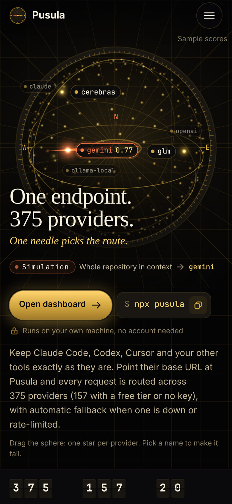

# README (Türkçe)

🌐 **Languages:** 🇺🇸 [English](../../../README.md) · 🇩🇪 [de](../de/README.md) · 🇮🇷 [fa](../fa/README.md)

---

<div align="center">

<a href="https://pusula.fyajan.com/landing"></a>
<a href="https://pusula.fyajan.com/landing"></a>

<br/>

[](https://pusula.fyajan.com/landing)

<sub>Yenilenen tanıtım sayfası <a href="https://pusula.fyajan.com/landing">pusula.fyajan.com/landing</a> adresinde yayında. Sayaçlar sayfa açılırken kaynak koddaki verilerden hesaplanır; gördüğünüz yönlendirme bir simülasyondur.</sub>

<br/>
<br/>

# 🧭 Pusula — Ücretsiz Yapay Zeka Ağ Geçidi


</div>

<div align="center">

## 💰 Ayda ~1,62 Milyar Ücretsiz Token

</div>

> Ücretsiz katmanları elle bir araya getirmek zahmetlidir — onlarca SDK, onlarca hız sınırı ve gerçekte ne kadar kotanız olduğuna dair hiçbir fikir yok. Pusula, **34 yinelenen havuz anahtarında 467 ücretsiz katman girdisini** kataloglar ve token başlığını, **yayımlanmış pozitif aylık bütçeye sahip 17 havuz ile modele özel beş Groq sınırından**, ortak havuzları tekilleştirerek hesaplar. Yalnızca bölgesel kimlik doğrulamasından sonra kullanılabilen kotalar (bugün için: ModelScope) ayrı gösterilir; bölgesel kimlik doğrulamasının arkasındaki +~6M hiçbir zaman başlıktaki toplama dahil edilmez. Sonuç kontrol panelinde (`/dashboard/free-tiers`) görünür kalır.


> Canlı `/dashboard/free-tiers` sayfasının animasyonlu özeti. Tam metodoloji (havuz tekilleştirme, kredi katmanları, sağlayıcı koşulları): **[docs/reference/FREE_TIERS.md](docs/reference/FREE_TIERS.md)**.
>
> <sub>Bu rakamlar doğrudan ücretsiz katman kataloğundan gelir (son düzenleme: 2026-10-19) ve **her iki yönde de değişir** — bir sağlayıcı ücretsiz katmanını sonlandırırsa sayı düşer; yenisi eklenirse yükselir. Yuvarlanarak artırılmış en iyi senaryoyu değil, her zaman kataloğun gerçekten hesapladığı değeri yayımlarız.</sub>

<br/>

<div align="center">

<h3>

⭐ PUSULA para tasarrufu yapmanıza ve işinizi kolaylaştırmanıza yardımcı olduysa repoya yıldız verin.

</h3>

[](https://github.com/Ferhat-Yasinoglu/pusula)

### 💬 Sorular ve destek

[](https://github.com/Ferhat-Yasinoglu/pusula/issues)

**Hatalar, özellik istekleri ve sorular → [bir issue açın](https://github.com/Ferhat-Yasinoglu/pusula/issues) · Planlananlar → [ROADMAP.md](../../../ROADMAP.md)**

<br/>

## 🧩 Kullanılabilir

[](https://www.npmjs.com/package/pusula)

[](https://github.com/Ferhat-Yasinoglu/pusula/pkgs/container/pusula)
[](https://pusula.fyajan.com/landing)
[](../../../LICENSE)

<table>
  <tr>
    <td align="right"><b>🆕 Yeni</b></td>
    <td align="center"><a href="#-yenilikler">🆕 Yenilikler</a></td>
    <td align="center"><a href="https://pusula.fyajan.com/landing">🌍 Canlı demo</a></td>
    <td align="center"><a href="#-ekran-görüntüleri">📸 Ekran görüntüleri</a></td>
  </tr>
  <tr>
    <td align="right"><b>🚀 Başlangıç</b></td>
    <td align="center"><a href="#-hızlı-başlangıç">🚀 Hızlı Başlangıç</a></td>
    <td align="center"><a href="#-daha-fazla-kurulum-yöntemi--docker-bun-kaynak-kod-pnpm-nix-podman">📦 Kurulum</a></td>
    <td align="center"><a href="#-kur-sağlayıcı-bağla-yönlendir">🆓 İlk istek</a></td>
  </tr>
  <tr>
    <td align="right"><b>💡 Öğrenin</b></td>
    <td align="center"><a href="#-vaat">💥 Vaat</a></td>
    <td align="center"><a href="#-neden-pusula">🤔 Neden Pusula?</a></td>
    <td align="center"><a href="#-pusulayı-farklı-kılan-nedir">🏆 Fark Yaratan Özellikler</a></td>
  </tr>
  <tr>
    <td align="right"><b>⚙️ Özellikler</b></td>
    <td align="center"><a href="#-kombolar--amiral-gemisi">🎯 Kombolar</a></td>
    <td align="center"><a href="#-375-ai-sağlayıcısı--153ü-katalogda-ücretsiz-etiketli">🌐 Sağlayıcılar</a></td>
    <td align="center"><a href="#-tam-cli--a2a-ve-mcp">🔌 CLI ve MCP</a></td>
  </tr>
  <tr>
    <td align="right"></td>
    <td align="center"><a href="#%EF%B8%8F-tokenlardan-1595-tasarruf-edin--otomatik-olarak">🗜️ Sıkıştırma</a></td>
    <td align="center"><a href="#%EF%B8%8F-pusula-nerede-çalışır--her-yerde">🖥️ Nerede Çalışır?</a></td>
    <td align="center"><a href="#-gizli-ve-önce-yerel-local-first">🔒 Gizli</a></td>
  </tr>
  <tr>
    <td align="right"><b>👀 Görün</b></td>
    <td align="center"><a href="#-uyumlu-clilar-ve-kodlama-ajanları">🤖 Uyumlu CLI'lar</a></td>
    <td align="center"><a href="#-topluluk-ve-yardım">💬 Topluluk ve Yardım</a></td>
    <td align="center"><a href="#-katkıda-bulunma">👥 Katkıda Bulunma</a></td>
  </tr>
  <tr>
    <td align="right"><b>📦 Proje</b></td>
    <td align="center"><a href="#%EF%B8%8F-teknoloji-yığını">🛠️ Teknoloji Yığını</a></td>
    <td align="center"><a href="#-dokümantasyon">📖 Belgeler</a></td>
    <td align="center"><a href="#-lisans">📄 Lisans</a></td>
  </tr>
</table>

</div>

<div align="center">
  <b>🌐 4 dilde</b>
  <br/><br/>
  <a href="../../../README.md"></a>
  <a href="README.md"></a>
  <a href="../de/README.md"></a>
  <a href="../fa/README.md"></a>
</div>

<br/>
<br/>

<div align="center">

## 🆕 Yenilikler

</div>

<sub>1.0.0 sürümünden (2026-10-20) sonra <code>main</code> dalına girenler, en yeniden eskiye. Ayrıntılı notlar → <a href="../../../CHANGELOG.md">CHANGELOG.md</a></sub>

- **🛰️ Kendini güncelleyen sunucu kurulumu** ([#45](https://github.com/Ferhat-Yasinoglu/pusula/pull/45)) — [`scripts/ops/vps-auto-update/`](../../../scripts/ops/vps-auto-update/README.md), `ghcr.io/ferhat-yasinoglu/pusula:main` imajını yaklaşık 15 dakikada bir çeken bir systemd zamanlayıcısı kurar. Her güncellemeden önce veri dizini yedeklenir, yeni konteyner bir sağlık kontrolünden geçmek zorundadır ve başarısız olursa otomatik olarak önceki sürüme dönülür. Güncelleme çekme (pull) yöntemiyle yapılır; sunucunuza dışarıdan hiçbir bağlantı kurulmaz.
- **🌍 Herkese açık canlı örnek** — [pusula.fyajan.com](https://pusula.fyajan.com/landing) `:main` imajıyla çalışıyor ve bu güncelleyici sayesinde kendini güncel tutuyor.
- **⬆️ Üst kaynak OmniRoute v3.8.52 ile eşitlendi** ([#39](https://github.com/Ferhat-Yasinoglu/pusula/pull/39)) — sağlayıcı kataloğu **358'den 375'e** çıktı ve **23 yeni veritabanı migrasyonu** geldi (186 → 209 SQL dosyası); Pusula'nın tasarımı, markası ve dört dili olduğu gibi korundu.
- **🪶 Headless mod** (eşitlemeyle geldi) — `pusula serve --headless` ya da `PUSULA_HEADLESS=1`, OpenAI uyumlu API'yi `/v1/*` altında açık tutar ve panoyu kapatır. → [Headless Mode](../../guides/HEADLESS.md)
- **🚫 Anahtarsız "OpenCode Free" kaldırıldı** (eşitlemeyle geldi) — OpenCode operatörünün kaldırma talebine uyularak `opencode` sağlayıcısı (`oc/…`) çıkarıldı; `opencode-zen`, `opencode-go` ve OpenCode istemci entegrasyonları yerinde duruyor. `auto` artık sizin bağladığınız sağlayıcılar arasında yönlendirme yapıyor. → [Kaldırılan sağlayıcılar](docs/reference/REMOVED_PROVIDERS.md)
- **🐛 Düzeltmeler** — `POST /api/keys/groups` artık 405 hatası vermiyor, yani anahtar grupları API üzerinden oluşturulabiliyor ([#37](https://github.com/Ferhat-Yasinoglu/pusula/pull/37)); CLI algılaması, projenin kendi `node_modules/.bin` dizini yüzünden Continue'yu artık kurulu sanmıyor ([#35](https://github.com/Ferhat-Yasinoglu/pusula/pull/35)); kullanılmayan `mermaid` bağımlılığı kaldırıldı ([#38](https://github.com/Ferhat-Yasinoglu/pusula/pull/38)); ayrıca yalnızca `main` dalıyla çalışan depo için CI düzeltmeleri ([#36](https://github.com/Ferhat-Yasinoglu/pusula/pull/36), [#43](https://github.com/Ferhat-Yasinoglu/pusula/pull/43)) ve ara sıra başarısız olan üç testin kararlı hale getirilmesi ([#44](https://github.com/Ferhat-Yasinoglu/pusula/pull/44)).
- **🧭 Yeniden tasarlanan tanıtım sayfası** ([#33](https://github.com/Ferhat-Yasinoglu/pusula/pull/33)) — pusula ve iğne temalı bir giriş bölümü ile yedi istasyon daha (ağ haritası, sağlayıcı kataloğu, yönlendirme, dayanıklılık, araçlar, makine dairesi, fırlatma); hepsini tek bir simüle edilmiş ağ geçidi yönetiyor. → [Canlı demo](https://pusula.fyajan.com/landing) · [Ekran görüntüleri](#-ekran-görüntüleri)

<br/>

<div align="center">

## 🆓 Kur, sağlayıcı bağla, yönlendir

</div>


```bash
# En az bir sağlayıcı bağladıktan sonra (Pano → Sağlayıcılar), `auto` onun üzerinden yönlendirir:
curl http://localhost:20128/v1/chat/completions \
  -H "Content-Type: application/json" \
  -d '{"model":"auto","messages":[{"role":"user","content":"Hello!"}]}'
```

<sub>Belirli bir arka ucu mu tercih ediyorsunuz? Onu doğrudan `<alias>/<model>` biçiminde çağırın (takma adlar [docs/reference/PROVIDER_REFERENCE.md](docs/reference/PROVIDER_REFERENCE.md) sayfasında listelenir). Ardından `auto`'ya geçin ve seçimi Pusula'ya bırakın.</sub>

<sub>📦 **Python, Node.js, PHP ve cURL** için kopyala-yapıştır hızlı başlangıç betikleri → [`examples/quickstart/`](../../../examples/quickstart/)</sub>

<br/>

<div align="center">

# 💥 Vaat

</div>


<br/>
<br/>

<div align="center">

# 🤔 Neden Pusula?

</div>


<div align="center">


</div>

<br/>

<div align="center">

## 🎯 Kombolar — Amiral Gemisi

</div>


> Bir **kombo**, Pusula'nın **otomatik olarak** yönlendirme yaptığı model zinciridir. Kota bittiğinde, bir sağlayıcı hata verdiğinde ya da maliyetler fırladığında kombo, uygun ve sağlıklı bir sonraki modele geçebilir. 🛡️

### ⚡ Sıfır yapılandırma — sadece `auto` kullanın

Oluşturulacak bir kombo yok. Modelinizi `auto` (veya bir varyantı) olarak ayarlayın; Pusula bağlı sağlayıcılarınızdan canlı olarak puanlanan sanal bir kombo oluşturur:

<table>
  <tr><th align="left">Model ID</th><th align="left">Neyi optimize eder</th></tr>
  <tr><td align="left" nowrap><code>auto</code></td><td align="left">🎯 Dengeli varsayılan (LKGP — son başarılı sağlayıcınıza sadık kalır)</td></tr>
  <tr><td align="left" nowrap><code>auto/coding</code></td><td align="left">🧑‍💻 Kod üretimi için kalite öncelikli ağırlıklar</td></tr>
  <tr><td align="left" nowrap><code>auto/fast</code></td><td align="left">⚡ Öncelikli olarak en düşük gecikme süresi</td></tr>
  <tr><td align="left" nowrap><code>auto/cheap</code></td><td align="left">💰 Öncelikli olarak token başına en ucuz model</td></tr>
  <tr><td align="left" nowrap><code>auto/offline</code></td><td align="left">🔋 Öncelikli olarak en fazla kota / hız sınırı payı olan model</td></tr>
  <tr><td align="left" nowrap><code>auto/smart</code></td><td align="left">🔭 Kalite öncelikli + daha iyi modeller keşfetmek için %10 keşif payı</td></tr>
  <tr><td align="left" nowrap><code>auto/lkgp</code></td><td align="left">📌 Son başarılı sağlayıcıya açıkça bağlı kalır (last-known-good-provider)</td></tr>
  <tr><td align="left" nowrap><code>auto/chaos</code></td><td align="left">🧪 Aynı istemi en kararlı bağlı modellere paralel gönderir ve tüm yanıtları akış halinde geri döndürür (hakem yok)</td></tr>
</table>

##

### 🔀 Veya kendinizinkini oluşturun — 20 yönlendirme stratejisi

Tüm **20** strateji — kombo adımı başına karıştırın ve eşleştirin:

<table>
  <tr>
    <th>#</th>
    <th align="left">Strateji</th>
    <th align="left">Ne yapar</th>
  </tr>
  <tr>
    <td align="center">1</td>
    <td nowrap><code>priority</code></td>
    <td>İlk hedeften sıralı liste — sonrakine geçmeden önce her birini tüketir 🥇</td>
  </tr>
  <tr>
    <td align="center">2</td>
    <td nowrap><code>fill-first</code></td>
    <td>Devam etmeden önce her hedefin kotasını tamamen doldurur</td>
  </tr>
  <tr>
    <td align="center">3</td>
    <td nowrap><code>weighted</code></td>
    <td>Hedef başına ağırlığa göre ağırlıklı rastgele seçim</td>
  </tr>
  <tr>
    <td align="center">4</td>
    <td nowrap><code>round-robin</code></td>
    <td>Hedefler arasında sırayla döner</td>
  </tr>
  <tr>
    <td align="center">5</td>
    <td nowrap><code>p2c</code></td>
    <td>İki seçenekli güç (power-of-two-choices) rastgele yük dengeleme</td>
  </tr>
  <tr>
    <td align="center">6</td>
    <td nowrap><code>least-used</code></td>
    <td>Mevcut yükü en düşük olan hedefi seçer</td>
  </tr>
  <tr>
    <td align="center">7</td>
    <td nowrap><code>random</code></td>
    <td>Tekdüze rastgele seçim (tekilleştirilmiş)</td>
  </tr>
  <tr>
    <td align="center">8</td>
    <td nowrap><code>strict-random</code></td>
    <td>Karıştırılmış deste — yeniden karıştırmadan önce her hedefi bir kez kullanır 🎲</td>
  </tr>
  <tr>
    <td align="center">9</td>
    <td nowrap><code>cost-optimized</code></td>
    <td>Canlı katalog fiyatlandırması üzerinden istek başına maliyeti ($) en aza indirir 💸</td>
  </tr>
  <tr>
    <td align="center">10</td>
    <td nowrap><code>headroom</code></td>
    <td>En çok kalan kotası olan hedefi seçer</td>
  </tr>
  <tr>
    <td align="center">11</td>
    <td nowrap><code>quota-weighted</code></td>
    <td>Kotası tükenmiş hesapları atlar, kalanlar arasından kalan kota ÷ işlemdeki yük oranıyla orantılı seçim yapar; süren konuşmalar aynı hesapta kalır</td>
  </tr>
  <tr>
    <td align="center">12</td>
    <td nowrap><code>reset-window</code></td>
    <td>Kota penceresi en erken sıfırlanacak hedefi tercih eder</td>
  </tr>
  <tr>
    <td align="center">13</td>
    <td nowrap><code>reset-aware</code></td>
    <td>Kota sıfırlama süresine göre sıralar — kısa pencereler önce 📊</td>
  </tr>
  <tr>
    <td align="center">14</td>
    <td nowrap><code>context-relay</code></td>
    <td>Uzun konuşmalarda bağlamı hedefler arasında devreder 🧠</td>
  </tr>
  <tr>
    <td align="center">15</td>
    <td nowrap><code>context-optimized</code></td>
    <td>Mevcut bağlam boyutu için en uygun modeli seçer</td>
  </tr>
  <tr>
    <td align="center">16</td>
    <td nowrap><code>cache-optimized</code></td>
    <td>Her yeniden kullanılabilir istem önekini aynı hesaba sabitler — istem önbelleği (prompt-cache) isabetlerini maksimize eder 🎯</td>
  </tr>
  <tr>
    <td align="center">17</td>
    <td nowrap><code>lkgp</code></td>
    <td>Son Bilinen İyi Yol (Last-Known-Good Path) — son başarılı sağlayıcıya bağlı kalır, ardından kurallara döner</td>
  </tr>
  <tr>
    <td align="center">18</td>
    <td nowrap><code>auto</code></td>
    <td>Tüm bağlantılar arasında 16 faktörlü canlı puanlama 🤖</td>
  </tr>
  <tr>
    <td align="center">19</td>
    <td nowrap><code>fusion</code></td>
    <td>Bir model paneline paralel dağıtır + bir hakem model tek bir nihai yanıt sentezler 🧬</td>
  </tr>
  <tr>
    <td align="center">20</td>
    <td nowrap><code>pipeline</code></td>
    <td>Adımları birbirine bağlar — her hedefin çıktısı sonrakini besler 🔗</td>
  </tr>
</table>

<sub>Auto-Combo motoru her adayı **16 faktör** üzerinden puanlar (sağlık, kota, maliyet, gecikme, göreve uygunluk, kalite, oturum uygunluğu…) — bkz. [`docs/routing/AUTO-COMBO.md`](docs/routing/AUTO-COMBO.md).</sub>

##

### 🧱 Dayanıklılık yerleşiktir (3 bağımsız katman)


<sub>📖 [Auto-Combo Motoru](docs/routing/AUTO-COMBO.md) · [Dayanıklılık Kılavuzu](docs/architecture/RESILIENCE_GUIDE.md)</sub>

<br/>

<div align="center">

## 🏆 Pusula'yı Farklı Kılan Nedir

</div>


<sub>📊 Tam metodoloji ve özellik bazında detay vs 9router, OpenRouter, CLIProxyAPI &amp; LiteLLM → [`docs/comparison/PUSULA_VS_ALTERNATIVES.md`](docs/comparison/PUSULA_VS_ALTERNATIVES.md)</sub>

<br/>

<div align="center">

## 📸 Ekran Görüntüleri


<sub><code>http://localhost:20128</code> adresindeki pano — yeni kurulum, henüz hiçbir sağlayıcı bağlanmamış.</sub>

</div>

<details>
<summary><b>Tanıtım sayfası istasyonları</b> — Ağ, Katalog ve Yönlendirme (masaüstü)</summary>
<br/>
<p align="center"></p>
</details>

<br/>

<div align="center">

## 🤖 Uyumlu CLI'lar ve Kodlama Ajanları

> Tek bir yapılandırma — `http://localhost:20128/v1` — ile **tüm** yapay zekâ IDE'leri veya CLI'ları ücretsiz ve düşük maliyetli modellerde çalışır.

<div align="center">
<table>
  <tr>
    <td align="center" width="76"><a href="https://github.com/anthropics/claude-code"><br/><sub><b>Claude Code</b></sub><br/><sub>                           </sub></a></td>
    <td align="center" width="76"><a href="https://github.com/openai/codex"><br/><sub><b>Codex CLI</b></sub><br/><sub>                           </sub></a></td>
    <td align="center" width="76"><picture><source media="(prefers-color-scheme:dark)" srcset="https://cdn.jsdelivr.net/npm/@lobehub/icons-static-png@1.91.0/dark/cline.png"/></picture><br/><sub><b>Cline</b></sub><br/><sub>                           </sub></td>
    <td align="center" width="76"><a href="https://github.com/Kilo-Org/kilocode"><br/><sub><b>Kilo Code</b></sub><br/><sub>                           </sub></a></td>
    <td align="center" width="76"><a href="https://docs.roocode.com/"><br/><sub><b>Roo Code</b></sub><br/><sub>                           </sub></a></td>
    <td align="center" width="76"><br/><sub><b>Continue</b></sub><br/><sub>                           </sub></td>
  </tr>
  <tr>
    <td align="center" width="76"><br/><sub><b>Aider</b></sub><br/><sub>                           </sub></td>
    <td align="center" width="76"><br/><sub><b>ForgeCode</b></sub><br/><sub>                           </sub></td>
    <td align="center" width="76"><br/><sub><b>jcode</b></sub><br/><sub>                           </sub></td>
    <td align="center" width="76"><br/><sub><b>DeepSeek TUI</b></sub><br/><sub>                           </sub></td>
    <td align="center" width="76"><br/><sub><b>CodeWhale</b></sub><br/><sub>                           </sub></td>
    <td align="center" width="76"><a href="https://github.com/anomalyco/opencode"><br/><sub><b>OpenCode</b></sub><br/><sub>                           </sub></a></td>
  </tr>
  <tr>
    <td align="center" width="76"><br/><sub><b>Factory Droid</b></sub><br/><sub>                           </sub></td>
    <td align="center" width="76"><br/><sub><b>Copilot CLI</b></sub><br/><sub>                           </sub></td>
    <td align="center" width="76"><br/><sub><b>Cursor CLI</b></sub><br/><sub>                           </sub></td>
    <td align="center" width="76"><br/><sub><b>Smelt</b></sub><br/><sub>                           </sub></td>
    <td align="center" width="76"><br/><sub><b>Pi</b></sub><br/><sub>                           </sub></td>
    <td align="center" width="76"><br/><sub><b>Grok Build</b></sub><br/><sub>                           </sub></td>
  </tr>
  <tr>
    <td align="center" width="76"><picture><source media="(prefers-color-scheme:dark)" srcset="https://cdn.jsdelivr.net/npm/@lobehub/icons-static-png@1.91.0/dark/nousresearch.png"/></picture><br/><sub><b>Hermes Agent</b></sub><br/><sub>                           </sub></td>
    <td align="center" width="76"><br/><sub><b>OpenClaw</b></sub><br/><sub>                           </sub></td>
    <td align="center" width="76"><picture><source media="(prefers-color-scheme:dark)" srcset="https://cdn.jsdelivr.net/npm/@lobehub/icons-static-png@1.91.0/dark/goose.png"/></picture><br/><sub><b>Goose</b></sub><br/><sub>                           </sub></td>
    <td align="center" width="76"><br/><sub><b>Open Interpreter</b></sub><br/><sub>                           </sub></td>
    <td align="center" width="76"><br/><sub><b>Warp AI</b></sub><br/><sub>                           </sub></td>
  </tr>
</table>
</div>

<div align="center">
<b>＋ ayrıca şunlarla da çalışır:</b> · Agent Deck · Crush · Zed · Qwen Code · Oh My Pi · Letta CLI · Prime Agent · 5dive · Kiro / Antigravity (MITM üzerinden) · <b>OpenAI uyumlu herhangi bir araç</b>
</div>

<sub>📖 37 aracın tümü için araç bazında kurulum (27 CLI Code + 10 CLI Agent) → [`docs/reference/CLI-TOOLS.md`](docs/reference/CLI-TOOLS.md) · 🧩 OpenCode eklentisi → [`@pusula/opencode-plugin`](../../../@pusula/opencode-plugin/README.md) (paketle birlikte gelir; `pusula setup opencode`)</sub>

</div>

<br/>

**Desteklenen herhangi bir CLI'ı Pusula üzerinden tek komutla başlatın** — hiçbir yapılandırma dosyası yazılmaz,
kimlik bilgileri işlem bazında enjekte edilir, Qwen/Gemini geçici ve yalıtılmış bir ana dizin kullanır:

```bash
pusula run claude   --model openai/gpt-5.4          # Claude Code
pusula run codex    --model glm/glm-5.2             # OpenAI Codex CLI
pusula run aider    --model glm/glm-5.2 -- --message "reply OK"
pusula run goose    --model glm/glm-5.2
pusula run opencode --model glm/glm-5.2 -- run "reply OK"
pusula run qwen     --model glm/glm-5.2 -- -p "reply OK"
pusula run gemini   --model glm/glm-5.2 -- --skip-trust -p "reply OK"

# Veya sağlayıcı+modeli etkileşimli olarak seçip aracın kendi yapılandırmasını yazın:
pusula configure codex          # ayrıca: claude opencode qwen aider goose gemini cline continue kilo
```

Her komut etkin uzak bağlama (`pusula connect <host>`) uyar; `--dry-run`,
çalıştırmadan tam ortam değişkenlerini/argümanları önizler ve `--api-key-env NAME`, gizli bilgileri
kabuk geçmişinizin dışında tutar. → [CLI Entegrasyonları](docs/guides/CLI-INTEGRATIONS.md)

<br/>

<div align="center">

## 🌐 375 AI Sağlayıcısı — 153'ü Katalogda Ücretsiz Etiketli

</div>

> Standart sohbet, medya, arama, yerel, bulut ajanı ve sistem koleksiyonlarında **375 kayıtlı sağlayıcı** bulunuyor; bunların **153'ü `hasFree: true` keşif meta verisi taşıyor**. Sohbet modeli kayıt defteri **statik modeli olan 239 sağlayıcıyı / 3.059 farklı sağlayıcı-model çiftini / 1.476 farklı model kimliğini** kapsıyor; ayrı ücretsiz kullanım bütçesi kataloğunda ise **model başına 467 satır**, **34 yinelenen havuz** ve **51 yinelenen/anahtarsız, sonsuza kadar ücretsiz sağlayıcı** bulunuyor. Bunlar bilerek farklı tutulan paydalardır; tanımlar ve havuz tekilleştirmeli hesaplamalar [Sağlayıcı Referansı](docs/reference/PROVIDER_REFERENCE.md) ve [Ücretsiz Katmanlar](docs/reference/FREE_TIERS.md) sayfalarında yer alır.

<div align="center">

### 🏢 Tüm büyük laboratuvarlar — tek bir uç nokta üzerinden

<table>
  <tr>
    <td align="center" width="80"><picture><source media="(prefers-color-scheme:dark)" srcset="https://cdn.jsdelivr.net/npm/@lobehub/icons-static-png@1.91.0/dark/openai.png"/></picture><br/><sub>OpenAI</sub><br/><sub>                           </sub></td>
    <td align="center" width="80"><br/><sub>Anthropic</sub><br/><sub>                           </sub></td>
    <td align="center" width="80"><br/><sub>Gemini</sub><br/><sub>                           </sub></td>
    <td align="center" width="80"><picture><source media="(prefers-color-scheme:dark)" srcset="https://cdn.jsdelivr.net/npm/@lobehub/icons-static-png@1.91.0/dark/grok.png"/></picture><br/><sub>xAI Grok</sub><br/><sub>                           </sub></td>
    <td align="center" width="80"><br/><sub>DeepSeek</sub><br/><sub>                           </sub></td>
    <td align="center" width="80"><br/><sub>Mistral</sub><br/><sub>                           </sub></td>
  </tr>
  <tr>
    <td align="center" width="80"><br/><sub>Qwen</sub><br/><sub>                           </sub></td>
    <td align="center" width="80"><br/><sub>Meta Llama</sub><br/><sub>                           </sub></td>
    <td align="center" width="80"><picture><source media="(prefers-color-scheme:dark)" srcset="https://cdn.jsdelivr.net/npm/@lobehub/icons-static-png@1.91.0/dark/groq.png"/></picture><br/><sub>Groq</sub><br/><sub>                           </sub></td>
    <td align="center" width="80"><br/><sub>NVIDIA</sub><br/><sub>                           </sub></td>
    <td align="center" width="80"><br/><sub>MiniMax</sub><br/><sub>                           </sub></td>
    <td align="center" width="80"><br/><sub>Cohere</sub><br/><sub>                           </sub></td>
  </tr>
  <tr>
    <td align="center" width="80"><br/><sub>Perplexity</sub><br/><sub>                           </sub></td>
    <td align="center" width="80"><br/><sub>HuggingFace</sub><br/><sub>                           </sub></td>
    <td align="center" width="80"><br/><sub>Together</sub><br/><sub>                           </sub></td>
    <td align="center" width="80"><br/><sub>Fireworks</sub><br/><sub>                           </sub></td>
    <td align="center" width="80"><br/><sub>Cloudflare</sub><br/><sub>                           </sub></td>
    <td align="center" width="80"><br/><sub>Baidu</sub><br/><sub>                           </sub></td>
  </tr>
</table>

<sub>…ve 350'den fazlası — her simge doğrudan kontrol panelinin sağlayıcı kataloğundan yüklenir. 📖 [Sağlayıcı Referansı](docs/reference/PROVIDER_REFERENCE.md)</sub>

<br/>

### 🆓 Sonsuza Kadar Ücretsiz — $0, kart gerekmez

<table>
  <tr>
    <td align="center" width="150"><br/><b>OpenCode Zen</b><br/><sub>DeepSeek V4, Nemotron 3<br/>Token sınırı yok</sub></td>
    <td align="center" width="150"><br/><b>Kilo Code</b><br/><sub>Otomatik yönlendirici, Tencent Hy3<br/>Sonsuza kadar ücretsiz</sub></td>
    <td align="center" width="150"><br/><b>Requesty</b><br/><sub>GPT-OSS 120B, Nemotron<br/>Sonsuza kadar ücretsiz</sub></td>
    <td align="center" width="150"><br/><b>Z.AI GLM</b><br/><sub>GLM-4.7 / 4.5-Flash<br/>Sonsuza kadar ücretsiz</sub></td>
    <td align="center" width="150"><br/><b>Baidu ERNIE</b><br/><sub>ERNIE 4.0<br/>Sonsuza kadar ücretsiz</sub></td>
  </tr>
  <tr>
    <td align="center" width="150"><br/><b>Pollinations</b><br/><sub>GPT, DeepSeek, Grok, Mistral<br/>Anahtar gerekmez</sub></td>
    <td align="center" width="150"><br/><b>Cloudflare AI</b><br/><sub>Llama 3.3, Qwen, GLM, Kimi<br/>Günde 10K nöron</sub></td>
    <td align="center" width="150"><br/><b>NVIDIA NIM</b><br/><sub>Kimi, GLM, DeepSeek<br/>Ücretsiz ~40 RPM</sub></td>
    <td align="center" width="150"><br/><b>OpenRouter</b><br/><sub>:free modeller<br/>+$10 → daha yüksek RPM</sub></td>
  </tr>
</table>

📖 Makine tarafından okunabilir tam katalog → [`docs/reference/PROVIDER_REFERENCE.md`](docs/reference/PROVIDER_REFERENCE.md)

<br/>
</div>

<div align="center">

## 🖥️ Pusula Nerede Çalışır — Her Yerde

</div>

> Aynı uygulama, sizin makineniz, sizin kurallarınız. Global npm kurulumundan Termux aracılığıyla **telefonunuza** kadar.

<table>
  <tr><th align="left">Platform</th><th align="left">Kurulum</th><th align="left">Öne Çıkanlar</th></tr>
  <tr><td align="left" nowrap>📦 <b>npm (global)</b></td><td align="left" nowrap><code>npm install -g pusula</code></td><td align="left">Tek komut, her işletim sistemi</td></tr>
  <tr><td align="left" nowrap>🐳 <b>Docker</b></td><td align="left" nowrap><code>docker run … ghcr.io/ferhat-yasinoglu/pusula</code></td><td align="left">Çoklu mimari desteği: <b>AMD64 + ARM64</b></td></tr>
  <tr><td align="left" nowrap>🖥️ <b>Masaüstü (Electron)</b></td><td align="left" nowrap><code>npm run electron:build</code></td><td align="left">Yerel pencere + sistem tepsisi — <b>Windows / macOS / Linux</b></td></tr>
  <tr><td align="left" nowrap>💪 <b>ARM</b></td><td align="left" nowrap>yerel <code>arm64</code></td><td align="left">Raspberry Pi, ARM sunucuları, Apple Silicon</td></tr>
  <tr><td align="left" nowrap>📱 <b>Android (Termux)</b></td><td align="left" nowrap><code>pkg install nodejs && npx -y pusula</code></td><td align="left"><b>Telefonunuzda</b> 7/24 çalışır, root gerektirmez</td></tr>
  <tr><td align="left" nowrap>📲 <b>PWA</b></td><td align="left" nowrap>"Ana Ekrana Ekle"</td><td align="left">Bağımsız uygulama penceresi, çevrimdışı sayfası, tarayıcıdan kurulabilir</td></tr>
  <tr><td align="left" nowrap>🧩 <b>OpenCode eklentisi</b></td><td align="left" nowrap><code>pusula setup opencode</code></td><td align="left">Paketle gelen <code>@pusula/opencode-plugin</code> eklentisini OpenCode'a kurar</td></tr>
  <tr><td align="left" nowrap>🛠️ <b>Kaynak koddan</b></td><td align="left" nowrap><code>npm install && npm run dev</code></td><td align="left">Üzerinde çalışın, katkıda bulunun</td></tr>
</table>

<sub>📖 [Docker Rehberi](docs/guides/DOCKER_GUIDE.md) · [Masaüstü](../../../electron/README.md) · [Termux](docs/guides/TERMUX_GUIDE.md) · [PWA](docs/guides/PWA_GUIDE.md) · [OpenCode](docs/frameworks/OPENCODE.md)</sub>

<br/>

<div align="center">

## 🔒 Gizli ve Önce Yerel (Local-First)

</div>


<sub>📖 [Yetkilendirme](docs/architecture/AUTHZ_GUIDE.md) · [Güvenlik Önlemleri](docs/security/GUARDRAILS.md) · [Uyumluluk](docs/security/COMPLIANCE.md)</sub>

<br/>

<div align="center">

## 🔌 Tam CLI + A2A ve MCP

</div>

> Sunucunun ötesinde, Pusula **80'den fazla komuta** sahip **kapsamlı bir komut satırı kokpitidir**; ayrıca bir yapay zeka ajanının onu **kendi başına** yönetebilmesi için açık ajan protokollerine sahiptir.

### ⌨️ Gerçek bir CLI (yalnızca `start` değil)

```bash
pusula               # ağ geçidini + panoyu sunar (port 20128)
pusula repl          # etkileşimli TUI sohbet (komutlar: /model /combo /skill /memory)
pusula setup         # rehberli ilk çalıştırma sihirbazı
pusula doctor        # yapılandırmayı, veritabanını, portları, Node çalışma zamanını ve yerel bağımlılıkları denetler
```

### 🛰️ Uzak mod — CLI'ı burada, Pusula'yı bir VPS üzerinde çalıştırın

Pusula bir sunucuda mı kurulu? Dizüstü bilgisayarınızdan **aynı CLI** ile yönetin. Kapsamlı bir erişim tokenıyla bir kez oturum açın; ardından her komut uzak sunucuyu hedefler.

```bash
pusula connect 192.168.0.15            # şifre → kapsamlı token, bağlam olarak kaydedilir
pusula models                         # ← UZAK sunucuya karşı çalışır
pusula configure codex                 # ← uzak bir model seçer, yerel bir Codex profili yazar
pusula tokens create --name ci --scope read   # diğer makineler için daha dar kapsamlı tokenlar üretir
pusula contexts use default            # ← yerel sunucuya geri döner
```

Tokenlar `read` / `write` / `admin` kapsamlarına sahiptir; süreç başlatan rotalar yalnızca yerel döngüde (loopback) kalır.
<sub>📖 [Uzak Mod](docs/guides/REMOTE-MODE.md)</sub>

<div align="left">


</div>

### 🤝 Bir ajan bağlayın — ve Pusula'nın kendisini yönetsin

Pusula'yı **MCP**, **A2A**, bir **REST API**, **webhook'lar** veya bir **uzak CLI** üzerinden kullanıma açın — yetenekli herhangi bir ajan (veya kendi kodunuz) tüm ağ geçidinin anahtarlarını alır: yönlendirme, sağlayıcılar, kombolar, önbellek, sıkıştırma, bellek — tamamen özerk bir şekilde. Aşağıdaki HTTP uç noktaları `http://localhost:20128` altında sunulur.

<table>
  <tr><th align="left">Arayüz</th><th align="left">Uç nokta / komut</th><th align="left">Kullanım amacı</th></tr>
  <tr><td align="left" nowrap>🧰 <b>MCP (stdio)</b></td><td align="left" nowrap><code>pusula --mcp</code></td><td align="left">Claude Desktop, Cursor veya herhangi bir MCP istemcisine bağlayın</td></tr>
  <tr><td align="left" nowrap>🌊 <b>MCP (HTTP)</b></td><td align="left" nowrap><code>/api/mcp/stream</code></td><td align="left">Uzak MCP — <b>110 araç</b>, 33 kapsam (zorunlu kılınması isteğe bağlı), eksiksiz denetim kaydı</td></tr>
  <tr><td align="left" nowrap>📡 <b>MCP (SSE)</b></td><td align="left" nowrap><code>/api/mcp/sse</code></td><td align="left">Akışlı MCP taşıması</td></tr>
  <tr><td align="left" nowrap>🤝 <b>A2A</b></td><td align="left" nowrap><code>/.well-known/agent.json</code></td><td align="left">Ajandan ajana (Agent-to-agent), <b>JSON-RPC 2.0</b> + SSE, 6 yetenek</td></tr>
  <tr><td align="left" nowrap>🌐 <b>REST API</b></td><td align="left" nowrap><code>/v1/*</code></td><td align="left">OpenAI uyumlu — sohbet, embeddings, görseller, ses, OCR</td></tr>
  <tr><td align="left" nowrap>🔔 <b>Webhook'lar</b></td><td align="left" nowrap><code>/api/webhooks</code></td><td align="left">İstek / kota olaylarını sohbet uygulamalarına veya herhangi bir URL'ye iletin</td></tr>
  <tr><td align="left" nowrap>🛰️ <b>Uzak CLI</b></td><td align="left" nowrap><code>pusula connect &lt;host&gt;</code></td><td align="left">Kapsamlı erişim tokenlarıyla uzak bir örneği yönetin</td></tr>
</table>

```bash
# Claude Code'a MCP üzerinden tam Pusula araç setini verin:
pusula mcp enable --transport streamable-http
claude mcp add --transport http pusula http://localhost:20128/api/mcp/stream --header "Authorization: Bearer <api-key-with-management-access>"
```

<sub>📖 [MCP Sunucusu](docs/frameworks/MCP-SERVER.md) · [A2A Sunucusu](docs/frameworks/A2A-SERVER.md) · [Ajan Protokolleri](docs/frameworks/AGENT_PROTOCOLS_GUIDE.md)</sub>

<br/>

<div align="center">

## 🗜️ Tokenlardan %15–95 Tasarruf Edin — Otomatik Olarak

</div>

### 📖 Nasıl çalışır — işlem hattı, mimari ve tasarruf matematiği


Varsayılan katmanlı kombo `RTK → Caveman` çalıştırır. Her ikisi de aynı araç/bağlam yükü üzerinde çalıştığında, tasarruflar katlanarak artar:

```txt
combined = 1 − (1 − RTK) × (1 − Caveman_input)
average  = 1 − (1 − 0.80) × (1 − 0.46) = 89.2%
range    = 78.4 – 94.6%
```

Kod blokları, URL'ler, JSON ve yapılandırılmış veriler koruma motoru tarafından **her zaman korunur**.

> **Az token işi görüyorsa neden çok token kullanasınız?** Her istek Pusula'nın sıkıştırma hattından **şeffaf bir şekilde** geçer — istemci değişikliği gerekmez. Artık sırayla çalışan ve yönlendirme kombosu başına karıştırılıp eşleştirilebilen **12 birleştirilebilir motordan oluşan bir yığındır** — [RTK](https://github.com/rtk-ai/rtk), [Caveman](https://github.com/JuliusBrussee/caveman), [LLMLingua-2](https://github.com/microsoft/LLMLingua) ve [Troglodita](https://github.com/leninejunior/troglodita) (PT-BR) fikirleri üzerine inşa edilmiştir.

### 🧱 12 motorlu sıkıştırma yığını

Motorlar işlem hattı sırasına göre çalışır; her biri bağımsız olarak açılıp kapatılabilir ve kombo başına yapılandırılabilir:

<table>
  <tr><th align="center">#</th><th align="left">Motor</th><th align="left">Ne yapar</th></tr>
  <tr><td align="center" nowrap>1</td><td align="left" nowrap><b>Session-Dedup</b></td><td align="left">Turlar arasında tekrarlanan içerikleri çıkarır (içerik adresli, turlar arası)</td></tr>
  <tr><td align="center" nowrap>2</td><td align="left" nowrap><b>CCR</b></td><td align="left">Büyük blokları geri getirme işaretçilerinin arkasında arşivler, talep üzerine getirir</td></tr>
  <tr><td align="center" nowrap>3</td><td align="left" nowrap><b>Lite</b></td><td align="left">Boşluklar + görsel URL'lerini kırpar (düşük gecikmeli temel hat)</td></tr>
  <tr><td align="center" nowrap>4</td><td align="left" nowrap><b>RTK</b></td><td align="left">Akıllı araç sonucu filtreleme, tekilleştirme ve kırpma (komut duyarlı)</td></tr>
  <tr><td align="center" nowrap>5</td><td align="left" nowrap><b>Responses Tool Output</b></td><td align="left">Kabuk/yama/arama/derleme çıktıları için kayıpsız öncelikli JSON + sınırlı tanısal sıkıştırma (Responses API)</td></tr>
  <tr><td align="center" nowrap>6</td><td align="left" nowrap><b>Headroom</b></td><td align="left">Yerleşik bir <b>GCF</b> codec'i aracılığıyla JSON dizilerinin kayıpsız tablosal sıkıştırılması (~%30)</td></tr>
  <tr><td align="center" nowrap>7</td><td align="left" nowrap><b>Relevance</b></td><td align="left">Son kullanıcı sorgusuna göre çıkarımsal cümle puanlaması</td></tr>
  <tr><td align="center" nowrap>8</td><td align="left" nowrap><b>Caveman</b></td><td align="left">Kural tabanlı düz yazı sıkıştırması (çıktıda ~%65–75)</td></tr>
  <tr><td align="center" nowrap>9</td><td align="left" nowrap><b>Aggressive</b></td><td align="left">Özetleme + eski turların kademeli yaşlandırılması</td></tr>
  <tr><td align="center" nowrap>10</td><td align="left" nowrap><b>LLMLingua-2</b></td><td align="left">Bir TinyBERT ONNX modeliyle ML anlamsal budama (BERT-base isteğe bağlı) — kod güvenli, asenkron</td></tr>
  <tr><td align="center" nowrap>11</td><td align="left" nowrap><b>Ultra</b></td><td align="left">İsteğe bağlı küçük model (SLM) katmanıyla sezgisel token budama</td></tr>
  <tr><td align="center" nowrap>12</td><td align="left" nowrap><b>OmniGlyph</b></td><td align="left">Doğrudan Anthropic kablosu üzerindeki ölçülen Claude Fable 5 için deneysel görüntü olarak bağlam kodlama; GPT 5.6 dönüştürücüleri sağlayıcı dekontları beklenirken kapalı kalır. Dört sıkıştırma profili (agresif varsayılan, dengeli, kodlama güvenli, doğrudan geçiş) (en agresif; isteğe bağlı)</td></tr>
</table>

Kod blokları, URL'ler ve yapılandırılmış veriler **her zaman byte düzeyinde kusursuz korunur**. **Tek tıkla hazır önayarlar** motorları birleştirir:

<table>
  <tr><th align="left">Mod</th><th align="left">Tasarruf</th><th align="left">En uygun kullanım</th></tr>
  <tr><td align="left" nowrap>🪶 <b>Lite</b></td><td align="left" nowrap>~%15</td><td align="left">Her zaman açık güvenli varsayılan</td></tr>
  <tr><td align="left" nowrap>🪨 <b>Standard (Caveman)</b></td><td align="left" nowrap>~%30</td><td align="left">Günlük kodlama</td></tr>
  <tr><td align="left" nowrap>⚡ <b>Aggressive</b></td><td align="left" nowrap>~%50</td><td align="left">Uzun araç yoğun oturumlar</td></tr>
  <tr><td align="left" nowrap>🔥 <b>Ultra</b></td><td align="left" nowrap>~%75</td><td align="left">Maksimum tasarruf</td></tr>
  <tr><td align="left" nowrap>🧰 <b>RTK</b></td><td align="left" nowrap>%60–90</td><td align="left">Kabuk/test/derleme/git çıktısı</td></tr>
  <tr><td align="left" nowrap>🔗 <b>Katmanlı (RTK → Caveman)</b></td><td align="left" nowrap><b>%78–95</b></td><td align="left">Karışık istemler + araç günlükleri</td></tr>
</table>

**Gerçek örnek — Standard mod:**

> **Önce (69 token):** _"The reason your React component is re-rendering is likely because you're creating a new object reference on each render cycle. When you pass an inline object as a prop, React's shallow comparison sees it as a different object every time, which triggers a re-render. I would recommend using useMemo to memoize the object."_
>
> **Sonra (19 token):** _"New object ref each render. Inline object prop = new ref = re-render. Wrap in useMemo."_
>
> **Aynı yanıt. %72 daha az token. Sıfır doğruluk kaybı.** ✅

**PT-BR örneği — [Troglodita](https://github.com/leninejunior/troglodita) modu:**

> **Antes (42 tokens):** _"O problema é que o componente está re-renderizando porque uma nova referência de objeto está sendo criada em cada ciclo de renderização. Eu recomendaria usar useMemo."_
>
> **Depois (12 tokens):** _"Re-render: ref nova cada ciclo (objeto inline recriado). Usar `useMemo`."_
>
> **Mesma resposta. ~70% menos tokens. Precisão técnica intacta.** ✅

<br/>

### 🎚️ Motorların ötesinde — çıktı stilleri, uyarlanabilir kadran ve istek başına kontrol

Yukarıdaki 12 motor içeri giren metni küçültür. Üç ek katman ise **nasıl**, **ne zaman** ve **neyin** çıkacağını şekillendirir:

- **🪄 Çıktı Stilleri** _(çıktı ekseninde yönlendirme)_ — deterministik, önbellek güvenli yanıt şekillendirme talimatları enjekte eder; birleştirilebilir, her biri `lite` / `full` / `ultra` yoğunluğundadır. Yeni bir stil eklemek tek satırlık bir kayıt işlemidir:
  - **Terse prose** — dolgu sözcükleri / makaleleri / tereddütlü ifadeleri çıkarır; teknik içeriği eksiksiz korur.
  - **Less code** — "tembel kıdemli geliştirici" YAGNI yaklaşımı: istenmeyen iskele kodları olmadan çalışan en küçük değişiklik.
  - **Ponytail (lazy senior dev)** — YAGNI basamaklarını tırmanır, sorunu kökünden düzeltir, çalışan en küçük farkı üretir.
  - **I have ADHD (action-first)** — önce yapılacak iş gelir, adımlar numaralanır, tek bir somut sonraki adım verilir, giriş cümlesi olmaz.
  - **Terse CJK (文言)** — klasik Çince ultra kısa stil (`zh` diline kilitli).
- **🎯 Uyarlanabilir bağlam bütçesi** _(kadran)_ — tek bir açık/kapalı token eşiği yerine, yalnızca **modelin bağlam penceresine sığması için** gereken en ucuz ve en kayıpsız motorları kademeli olarak devreye sokar. İlke: `reserve-output` (varsayılan, model duyarlı) · `percentage` · `absolute`. Mod: `floor` (uyumu garanti eder) · `replace-autotrigger` (açık seçiminiz kazanır) · `off` (eski eşik).
- **🎛️ Sıkıştırmaya nerede karar verilir** _(öncelik sırası, yüksekten düşüğe)_ — istek başına `x-pusula-compression` başlığı › yönlendirme kombosu geçersiz kılma › aktif adlandırılmış profil › uyarlanabilir / otomatik tetikleyici › panel varsayılanı › kapalı. Uygulanan plan `X-Pusula-Compression: <mode>; source=<source>` yanıt başlığında geri döndürülür.

Token eşiğine göre otomatik tetikleyin, uyarlanabilir kadranı açın, adlandırılmış bir profil sabitleyin, istek başına tek seferlik ayarlayın veya yönlendirme kombosu başına bir işlem hattı atayın — iş yüküne hangisi uyuyorsa. İsteğe bağlı bir çevrimdışı **değerlendirme aracı** (`npm run eval:compression`), bir değişikliği yayımlamadan önce sabit bir külliyat üzerinde doğruluk ile tasarrufu puanlar.

📖 [`COMPRESSION_GUIDE.md`](docs/compression/COMPRESSION_GUIDE.md) · [`RTK_COMPRESSION.md`](docs/compression/RTK_COMPRESSION.md) · [`COMPRESSION_ENGINES.md`](docs/compression/COMPRESSION_ENGINES.md)

<br/>

<div align="center">

# ⚡ Hızlı Başlangıç

</div>

**1) Kurun ve çalıştırın**

```bash
npm install -g pusula
pusula
```

> 💡 `npm warn ERESOLVE` veya eş bağımlılık (peer-dep) uyarıları mı görüyorsunuz? [Zararsızdırlar](docs/guides/TROUBLESHOOTING.md#npm-install-uyarıları-eresolve--eş-bağımlılık--kullanımdan-kaldırılmış).
> **Gemini Web ya da çerez tabanlı başka bir web sağlayıcısı mı kullanıyorsunuz?** npm paketi
> Playwright'ı içerir ama onun Chromium ikili dosyasını içermez. İlk web sağlayıcısı isteğinden önce
> [Playwright Chromium kurulumu](docs/guides/TROUBLESHOOTING.md#gemini-web-ve-playwright-chromium)
> notuna göz atın.

Pano: `http://localhost:20128` · API: `http://localhost:20128/v1`.

**2) ÜCRETSİZ bir sağlayıcı bağlayın (kayıt gerekmez)**

Pano → **Sağlayıcılar (Providers)** → **UncloseAI** veya **AI Horde** gibi anahtarsız bir sağlayıcı bağlayın (API anahtarı yok, kayıt yok) → tamamlandı.

**3) Kodlama aracınızı yönlendirin**

```txt
Base URL: http://localhost:20128/v1
API Key:  [Pano → Uç Noktalar sayfasından kopyalayın]
Model:    auto            (sıfır yapılandırmalı akıllı yönlendirme — veya herhangi bir sağlayıcı/model)
```

**4) Çalıştığını doğrulayın**

```bash
curl http://localhost:20128/v1/models -H "Authorization: Bearer YOUR_KEY"
```

Bağlı modellerinizi listelenmiş olarak görmelisiniz. 🎉 İşte bu kadar — kodlamaya başlayın, gerisini Pusula otomatik yönlendirsin ve gerektiğinde diğerine geçsin.

İstemciniz özel başlıklar (custom headers) gönderemiyorsa, Pusula belirteçli uyumluluk takma adları da sunar:

```txt
OpenAI catalog:   http://localhost:20128/api/v1/vscode/YOUR_KEY/
OpenAI models:    http://localhost:20128/api/v1/vscode/YOUR_KEY/models
OpenAI chat:      http://localhost:20128/api/v1/vscode/YOUR_KEY/chat/completions
OpenAI responses: http://localhost:20128/api/v1/vscode/YOUR_KEY/responses
Ollama chat:      http://localhost:20128/api/v1/vscode/YOUR_KEY/api/chat
Ollama tags:      http://localhost:20128/api/v1/vscode/YOUR_KEY/api/tags
```

Bunları yalnızca `Authorization: Bearer ...` ekleyemeyen istemciler için kullanın. Başlık kimlik doğrulaması tercih edilen mod olmaya devam eder.

<br/>

## 📦 Daha fazla kurulum yöntemi — Docker, Bun, kaynak kod, pnpm, Nix, Podman

**🐳 Docker**

```bash
docker run -d --name pusula --restart unless-stopped --stop-timeout 40 \
  -p 127.0.0.1:20128:20128 -v pusula-data:/app/data ghcr.io/ferhat-yasinoglu/pusula:main
```

`:main` etiketi `main` dalına yapılan her push'ta yeniden derlenir. Henüz etiketli bir sürüm yayımlanmadığı için `:latest` ve `:X.Y.Z` etiketleri yok; sürümler yayımlandığında `:latest` en yüksek kararlı SemVer sürümünü takip eder, GitOps için `:X.Y.Z` ile bir sürümü sabitleyebilirsiniz. Bkz. [Docker Sürüm Kanalları](docs/guides/DOCKER_GUIDE.md#sürüm-kanalları). İmaj **`PUSULA_MEMORY_MB=1024`** değerini sabitler. Bu, pano ve hafif bir sohbet için yeterlidir. **Kodlama ajanları** (Claude Code, Codex, Grok, vb.'den gelen `POST /v1/responses`), çok daha büyük bir V8 heap alanına ihtiyaç duyar; aksi takdirde iki örtüşen uzun bağlam altında süreç ~12 GiB seviyesinde `FATAL ERROR` verir. Konteyneri heap boyutunun üzerinde boyutlandırın (yerel arabellekler V8'in dışında yer alır):

| İş Yükü                            | Heap (`-e PUSULA_MEMORY_MB`) | Konteyner (`--memory`) |
| ---------------------------------- | ---------------------------- | ---------------------- |
| Pano / hafif sohbet                | `1024` (imaj varsayılanı)    | ≥2 g                   |
| Tek bir kodlama ajanı              | `8192`                       | ≥10 g                  |
| İki eşzamanlı uzun `/v1/responses` | `10240`–`12288`              | ≥12–16 g               |

```bash
docker run -d --name pusula --restart unless-stopped --stop-timeout 40 \
  -e PUSULA_MEMORY_MB=8192 --memory=10g \
  -p 127.0.0.1:20128:20128 -v pusula-data:/app/data ghcr.io/ferhat-yasinoglu/pusula:main
```

Tam tablo: [Docker Kılavuzu — çalışma zamanı RAM](docs/guides/DOCKER_GUIDE.md#kodlama-ajanları-için-çalışma-zamanı-rami).

> **Geliştirme kanalı:** `ghcr.io/ferhat-yasinoglu/pusula:main` (ayrıca Chromium içeren `:main-web` ve
> `:main-bun`) `main` dalına yapılan her push'ta yeniden derlenir. https://pusula.fyajan.com bu imajla
> çalışır ve [`scripts/ops/vps-auto-update/`](../../../scripts/ops/vps-auto-update/README.md) içindeki
> çekme tabanlı güncelleyiciyle güncel tutulur. Bu etiketler değişkendir; sabitlenmiş bir üretim kanalı değildir.

**🥟 Bun**

Bun desteklenen bir çalışma zamanı değil, en iyi çaba esaslı bir uyumluluk yoludur: `bun install` ve `bun install -g pusula`, Bun çalışma zamanı algılamasıyla başlar:

- **Yerleşik `bun:sqlite`**: Pusula, Bun altında çalışırken Bun'ın yerleşik `bun:sqlite` sürücüsünü kullanır; Node.js altında `better-sqlite3` veya `sql.js`'e geri döner.
- **Geliştirmede otomatik Webpack paketleyici seçimi**: Bun çalışma zamanı altında geliştirme (`bun --bun run dev`) Bun'ı otomatik olarak algılar ve yerel V8 bağlama uyumsuzluklarını önlemek için Turbopack yerine Webpack kullanır. Üretim derlemeleri (`bun run build`) Node'daki gibi `PUSULA_USE_TURBOPACK` değerine uyar: varsayılan Turbopack'tir; Webpack ile derlemek için `PUSULA_USE_TURBOPACK=0` kullanın (`Dockerfile.bun` bunu bir `--build-arg` olarak sunar).
- **Özel Bun Dockerfile**: Yerel Bun üretim dağıtımları için çok aşamalı `Dockerfile.bun` (`docker build -f Dockerfile.bun -t pusula:bun .`).

```bash
# Bun ile kurun ve çalıştırın
bun install
bun --bun run dev
```

**🛠️ Kaynak koddan**

```bash
cp .env.example .env && npm install
PORT=20128 npm run dev
```

**📦 pnpm**

```bash
pnpm add -g pusula@latest --allow-build=better-sqlite3 --allow-build=@swc/core && pusula
```

**🔧 Nix (Flake)**

```bash
# Nix flakes kullanarak
nix develop
npm run dev
```

📖 [Docker Kılavuzu](docs/guides/DOCKER_GUIDE.md) — Compose profilleri, Caddy HTTPS, Cloudflare tünelleri.

**🦭 Podman**

```bash
# 1. Bind-mount veri dizinini hazırlayın
mkdir -p data

# 2. Yalnızca Linux + yerel rootless Podman (asla uzak Podman Machine istemcisi değil):
podman unshare chown 1000:1000 ./data

# 3. Çalışma zamanı ipucunu ayarlayın, yerel Compose imajını derleyin ve başlatın
echo "CONTAINER_HOST=podman" >> .env
podman compose --profile base up -d --build
```

macOS veya Windows üzerinde Podman uzak bir Podman Machine kullanır: `podman unshare` adımını atlayın ve
[topolojiye özel veri dizini rehberini](../../../contrib/podman/README.md#data-directory-permissions-by-topology) izleyin.

📖 [Podman Kılavuzu](../../../contrib/podman/README.md) — Compose derlemeleri, Podman Machine ve
Linux/systemd Quadlet kurulumu.

**⚡ Daha hızlı / daha hafif kurulum (yerel derlemeyi atlayın)**

Yerel SQLite motoru (`better-sqlite3`) **isteğe bağlı** bir bağımlılıktır; bu nedenle genel bir
kurulum asla kaynak koddan derlemeyi beklemez: platformunuza/Node sürümünüze uygun önceden derlenmiş bir ikili dosya olduğunda onu kullanır, aksi takdirde şeffaf bir şekilde saf JS motoruna
(Node 22+ üzerinde `node:sqlite`, aksi halde paketlenmiş `sql.js` WASM) geri döner — derleme araçları gerekmez.

Kurulum sonrası **yerel ısınma** adımını tamamen atlamak için (CI, headless veya yavaş makineler).
Not: bu yalnızca yerel SQLite ısınma adımını (`scripts/postinstall.mjs`) atlar; ikili kopyalama/onarım
kancası (`scripts/build/postinstall.mjs`) normal şekilde çalışmaya devam eder:

```bash
PUSULA_SKIP_POSTINSTALL=1 npm install -g pusula   # CI=1 de bunu atlar
```

En hızlı kurulumlar için **pnpm** tercih edin (içerik adresli depolama + hard linkler — yukarıya bakın).
Panosuz, headless bir çalışma zamanı için `pusula serve --headless` komutunu çalıştırın (ya da Docker
içinde de geçerli olan `PUSULA_HEADLESS=1` değişkenini ayarlayın) — bkz. [Headless Mode](../../guides/HEADLESS.md).
CLI ve web panosu aynı port üzerinde
aynı süreç tarafından sunulur, bu nedenle bugün için ayrı bir yalnızca CLI paketi bulunmamaktadır.

<br/>

<div align="center">

# 📧 Topluluk ve Yardım

> Her şey GitHub üzerinde — bir issue açın ya da bir pull request gönderin.

| Kanal                     | Nerede / Nasıl                                                                                                                                               |
| ------------------------- | ------------------------------------------------------------------------------------------------------------------------------------------------------------ |
| 🐛 **Hata bildirimi**     | [bir issue açın](https://github.com/Ferhat-Yasinoglu/pusula/issues) — `pusula doctor` çıktısını ekleyin (kaynak koddan çalışıyorsanız `npm run system-info`) |
| 💡 **Özellik isteği**     | özellik isteği şablonuyla [bir issue açın](https://github.com/Ferhat-Yasinoglu/pusula/issues/new/choose)                                                     |
| 💬 **Sorular ve yardım**  | [bir issue açın](https://github.com/Ferhat-Yasinoglu/pusula/issues/new/choose) — kurulum yardımı, sağlayıcı ipuçları, yol haritası fikirleri                 |
| 🔒 **Güvenlik bildirimi** | [özel güvenlik bildirimi](https://github.com/Ferhat-Yasinoglu/pusula/security/advisories/new) — bkz. [SECURITY.md](SECURITY.md)                              |
| 📦 **Kaynak kod**         | [github.com/Ferhat-Yasinoglu/pusula](https://github.com/Ferhat-Yasinoglu/pusula)                                                                             |
| 🤝 **Katkıda bulunun**    | [CONTRIBUTING.md](CONTRIBUTING.md) · [açık issue'lar](https://github.com/Ferhat-Yasinoglu/pusula/issues)                                                     |

</div>

---

<br/>
<div align="center">

## 🛠️ Teknoloji Yığını

</div>

<table>
  <tr><th align="left">Katman</th><th align="left">Teknoloji</th></tr>
  <tr><td nowrap><b>Çalışma Zamanı</b></td><td>Node.js 22.x (≥22.22.2) veya 24.x–26.x — <code>&gt;=22.22.2 &lt;23 || &gt;=24.0.0 &lt;27</code></td></tr>
  <tr><td nowrap><b>Dil</b></td><td>TypeScript 6.0 — <code>src/</code> ve <code>open-sse/</code>, 16 JS/CJS worker ve MITM ara katman (shim) dosyası dışında TypeScript'tir; <code>no-explicit-any</code> kuralı <code>open-sse/</code> ve <code>tests/</code> içinde hatadır, eski örnekler bir ratchet ile dondurulmuştur</td></tr>
  <tr><td nowrap><b>Çerçeve</b></td><td>Next.js 16 + React 19 + Tailwind CSS 4</td></tr>
  <tr><td nowrap><b>Veritabanı</b></td><td>better-sqlite3 (SQLite, WAL journaling) — <code>src/lib/db/</code> içinde 147 modül, 209 migrasyon</td></tr>
  <tr><td nowrap><b>Bellek</b></td><td>SQLite FTS5 tam metin + int8-nicelenmiş vektör gömüleri, tipik bozunma</td></tr>
  <tr><td nowrap><b>Şemalar</b></td><td>Zod 4 — MCP araç G/Ç doğrulama + API sözleşmeleri</td></tr>
  <tr><td nowrap><b>Protokoller</b></td><td>MCP (stdio / HTTP / SSE) + A2A v0.3 (JSON-RPC 2.0 + SSE)</td></tr>
  <tr><td nowrap><b>Akış</b></td><td>Server-Sent Events (SSE) + WebSocket köprüsü (<code>/v1/ws</code>)</td></tr>
  <tr><td nowrap><b>Sıkıştırma</b></td><td>12 motorlu işlem hattı — RTK, Caveman, Headroom (TOON/GCF codec'leri), LLMLingua-2 (TinyBERT ONNX), OmniGlyph</td></tr>
  <tr><td nowrap><b>Kimlik Doğrulama &amp; Güvenlik</b></td><td>OAuth 2.0 (PKCE) + JWT + API Anahtarları + MCP kapsamlı kimlik doğrulama · Depolanan veride AES-256-GCM · DOMPurify</td></tr>
  <tr><td nowrap><b>Gizlilik</b></td><td>wreq-js — JA3 / JA4 TLS parmak izi taklidi, 4 seviyeli proxy (hesap / sağlayıcı / kombo / genel)</td></tr>
  <tr><td nowrap><b>Esneklik</b></td><td>Devre kesici, üstel geri çekilme, anti-thundering-herd, otomatik-kombo kendi kendini onarma</td></tr>
  <tr><td nowrap><b>Günlükleme</b></td><td>pino — istek bağlamıyla yapılandırılmış JSON günlükleri</td></tr>
  <tr><td nowrap><b>Test</b></td><td>Node.js test çalıştırıcısı + Vitest — 7.900'den fazla izlenen test dosyasında (birim, entegrasyon, E2E, güvenlik, ekosistem) <b>56.000'den fazla statik test bildirimi</b></td></tr>
  <tr><td nowrap><b>Platformlar</b></td><td>Masaüstü (Electron) · Android (Termux) · PWA (herhangi bir tarayıcı)</td></tr>
  <tr><td nowrap><b>CI/CD</b></td><td>GitHub Actions — <code>main</code> dalına yapılan her push'ta GHCR imajları (<code>:main</code>, <code>:main-web</code>, <code>:main-bun</code>); her GitHub sürümünde npm yayını + sürüm numaralı GHCR etiketleri</td></tr>
  <tr><td nowrap><b>Bağlantılar</b></td><td><a href="https://github.com/Ferhat-Yasinoglu/pusula">GitHub</a> · <a href="https://www.npmjs.com/package/pusula">npm</a> · <a href="https://github.com/Ferhat-Yasinoglu/pusula/pkgs/container/pusula">GHCR</a> · <a href="https://pusula.fyajan.com/landing">Canlı örnek</a></td></tr>
</table>

<div align="center">

<br/>

## 📖 Dokümantasyon

</div>

### 📘 Başlarken

<table>
  <tr><th align="left">Belge</th><th align="left">Açıklama</th></tr>
  <tr><td nowrap><b><a href="docs/guides/USER_GUIDE.md">Kullanıcı Kılavuzu</a></b></td><td>Sağlayıcılar, kombinasyonlar, CLI entegrasyonu, dağıtım</td></tr>
  <tr><td nowrap><b><a href="docs/guides/SETUP_GUIDE.md">Kurulum Kılavuzu</a></b></td><td>Tüm kurulum yöntemleri, CLI aracı yapılandırmaları, protokol kurulumu, zaman aşımı ayarları</td></tr>
  <tr><td nowrap><b><a href="docs/reference/CLI-TOOLS.md">CLI Araçları Kılavuzu</a></b></td><td>Claude Code, Codex, Cursor, Cline, OpenClaw, Kilo ve Copilot için araca özel kurulum</td></tr>
  <tr><td nowrap><b><a href="docs/guides/REMOTE-MODE.md">Uzak Mod</a></b></td><td>Kapsamlı erişim belirteçleri aracılığıyla dizüstü bilgisayarınızın CLI'ından uzaktaki bir Pusula'yı (VPS) yönetin</td></tr>
  <tr><td nowrap><b><a href="docs/guides/CLAUDE-CODE-CONFIGURATION.md">Claude Code Yapılandırması</a></b></td><td><code>launch</code> ve model başına profillerle Claude Code'u Pusula'ya (yerel/uzak) yönlendirin</td></tr>
  <tr><td nowrap><b><a href="#-hızlı-başlangıç">Hızlı Başlangıç</a></b></td><td>4 adımda kurulum → bağlantı → yapılandırma → doğrulama</td></tr>
</table>

### 🔧 Operasyonlar ve Dağıtım

<table>
  <tr><th align="left">Belge</th><th align="left">Açıklama</th></tr>
  <tr><td nowrap><b><a href="docs/guides/DOCKER_GUIDE.md">Docker Kılavuzu</a></b></td><td>Docker çalıştırma, Compose profilleri, Caddy HTTPS, tüneller, imaj etiketleri</td></tr>
  <tr><td nowrap><b><a href="../../../contrib/podman/README.md">Podman Kılavuzu</a></b></td><td>Quadlet systemd birimleri (Linux), Linux/macOS/Windows üzerinde <code>podman compose</code>, veri dizini izinleri</td></tr>
  <tr><td nowrap><b><a href="docs/ops/VM_DEPLOYMENT_GUIDE.md">VM Dağıtımı</a></b></td><td>Eksiksiz kılavuz: VM + nginx + Cloudflare kurulumu</td></tr>
  <tr><td nowrap><b><a href="docs/ops/FLY_IO_DEPLOYMENT_GUIDE.md">Fly.io Dağıtımı</a></b></td><td>Kalıcı depolama ile Fly.io'ya dağıtım</td></tr>
  <tr><td nowrap><b><a href="docs/guides/TERMUX_GUIDE.md">Termux Kılavuzu</a></b></td><td>Pusula'yı Termux aracılığıyla Android'de çalıştırın</td></tr>
  <tr><td nowrap><b><a href="docs/guides/PWA_GUIDE.md">PWA Kılavuzu</a></b></td><td>Progresif Web Uygulaması kurulumu, önbelleğe alma, mimari</td></tr>
  <tr><td nowrap><b><a href="docs/guides/UNINSTALL.md">Kaldırma Kılavuzu</a></b></td><td>Tüm kurulum yöntemleri için temiz kaldırma</td></tr>
  <tr><td nowrap><b><a href="docs/reference/ENVIRONMENT.md">Ortam Yapılandırması</a></b></td><td>Tüm <code>.env</code> değişkenleri ve referansları</td></tr>
  <tr><td nowrap><b><a href="../../guides/HEADLESS.md">Headless Mod</a></b></td><td>Yalnızca proxy motorunu çalıştırın — <code>/v1/*</code> açık, pano kapalı</td></tr>
  <tr><td nowrap><b><a href="../../../scripts/ops/vps-auto-update/README.md">VPS Otomatik Güncelleme</a></b></td><td>Docker kurulumunu <code>ghcr.io/ferhat-yasinoglu/pusula:main</code> imajından güncelleyen, veri yedeği, sağlık kontrolü ve geri alma içeren çekme tabanlı systemd zamanlayıcısı</td></tr>
</table>

### 🧠 Özellikler ve Mimari

<table>
  <tr><th align="left">Belge</th><th align="left">Açıklama</th></tr>
  <tr><td nowrap><b><a href="docs/architecture/ARCHITECTURE.md">Mimari</a></b></td><td>Sistem mimarisi, veri akışı ve iç işleyiş</td></tr>
  <tr><td nowrap><b><a href="docs/compression/COMPRESSION_GUIDE.md">Sıkıştırma Kılavuzu</a></b></td><td>Sıkıştırma modları kapalı / hafif / standart / agresif / ultra / RTK / yığınlı; ayrıca kombo başına ve istek başına geçersiz kılmalar</td></tr>
  <tr><td nowrap><b><a href="docs/compression/RTK_COMPRESSION.md">RTK Sıkıştırması</a></b></td><td>Komut çıktısı sıkıştırması, filtreler, güven, doğrulama, ham çıktı kurtarma</td></tr>
  <tr><td nowrap><b><a href="docs/compression/COMPRESSION_ENGINES.md">Sıkıştırma Motorları</a></b></td><td>Caveman, RTK, yığınlı işlem hatları, pano/API/MCP arayüzleri</td></tr>
  <tr><td nowrap><b><a href="docs/compression/COMPRESSION_RULES_FORMAT.md">Sıkıştırma Kuralları Biçimi</a></b></td><td>Caveman ve RTK filtreleri için JSON kural paketi şemaları</td></tr>
  <tr><td nowrap><b><a href="docs/compression/COMPRESSION_LANGUAGE_PACKS.md">Sıkıştırma Dil Paketleri</a></b></td><td>Dil algılama ve Caveman kural paketi yazımı</td></tr>
  <tr><td nowrap><b><a href="docs/architecture/RESILIENCE_GUIDE.md">Dayanıklılık Kılavuzu</a></b></td><td>Devre kesiciler, bekleme süreleri, kuyruk, yoğun istek yığını önleme, TLS sahteciliği</td></tr>
  <tr><td nowrap><b><a href="docs/routing/AUTO-COMBO.md">Otomatik Kombinasyon Motoru</a></b></td><td>16 faktörlü puanlama, mod paketleri, kendi kendini iyileştirme</td></tr>
  <tr><td nowrap><b><a href="docs/ops/PROXY_GUIDE.md">Proxy Kılavuzu</a></b></td><td>4 seviyeli proxy sistemi (hesap / sağlayıcı / kombo / genel), 1proxy pazaryeri, kayıt defteri CRUD işlemleri</td></tr>
  <tr><td nowrap><b><a href="docs/reference/FREE_TIERS.md">Ücretsiz Katmanlar</a></b></td><td>Birleştirilmiş dizin: belgelenmiş 34 yinelenen havuz / kataloglanmış 467 ücretsiz katman girdisi</td></tr>
  <tr><td nowrap><b><a href="docs/guides/FEATURES.md">Özellik Galerisi</a></b></td><td>Ekran görüntüleriyle görsel pano turu</td></tr>
  <tr><td nowrap><b><a href="docs/architecture/CODEBASE_DOCUMENTATION.md">Kod Tabanı Dokümantasyonu</a></b></td><td>Yeni başlayanlara uygun kod tabanı tanıtımı</td></tr>
</table>

### 🤖 Protokoller ve API'ler

<table>
  <tr><th align="left">Belge</th><th align="left">Açıklama</th></tr>
  <tr><td nowrap><b><a href="docs/reference/API_REFERENCE.md">API Referansı</a></b></td><td>Örneklerle birlikte tüm uç noktalar</td></tr>
  <tr><td nowrap><b><a href="../../openapi.yaml">OpenAPI Belirtimi</a></b></td><td>OpenAPI 3.1 belirtimi</td></tr>
  <tr><td nowrap><b><a href="../../../open-sse/mcp-server/README.md">MCP Sunucusu</a></b></td><td>110 MCP aracı, IDE yapılandırmaları, Python/TS/Go istemcileri</td></tr>
  <tr><td nowrap><b><a href="docs/frameworks/MCP-SERVER.md">MCP Sunucusu Kılavuzu</a></b></td><td>MCP kurulumu, aktarımlar ve araç referansı</td></tr>
  <tr><td nowrap><b><a href="../../../src/lib/a2a/README.md">A2A Sunucusu</a></b></td><td>JSON-RPC 2.0 protokolü, beceriler, akış, görev yönetimi</td></tr>
  <tr><td nowrap><b><a href="docs/frameworks/A2A-SERVER.md">A2A Sunucusu Kılavuzu</a></b></td><td>A2A aracı kartı, görevler, beceriler ve akış</td></tr>
</table>

### 📋 Proje ve Kalite

<table>
  <tr><th align="left">Belge</th><th align="left">Açıklama</th></tr>
  <tr><td nowrap><b><a href="CONTRIBUTING.md">Katkıda Bulunma</a></b></td><td>Geliştirme kurulumu ve yönergeleri</td></tr>
  <tr><td nowrap><b><a href="CHANGELOG.md">Değişiklik Günlüğü</a></b></td><td>Sürüm bazında eksiksiz yayın geçmişi</td></tr>
  <tr><td nowrap><b><a href="SECURITY.md">Güvenlik Politikası</a></b></td><td>Güvenlik açıklarını bildirme ve güvenlik uygulamaları</td></tr>
  <tr><td nowrap><b><a href="docs/guides/I18N.md">i18n Kılavuzu</a></b></td><td>Arayüz çevirileri (İngilizce, Türkçe, Almanca, Farsça), çeviri iş akışı, RTL</td></tr>
  <tr><td nowrap><b><a href="docs/ops/RELEASE_CHECKLIST.md">Sürüm Kontrol Listesi</a></b></td><td>Sürüm öncesi doğrulama adımları</td></tr>
  <tr><td nowrap><b><a href="docs/ops/COVERAGE_PLAN.md">Kapsama Planı</a></b></td><td>Test kapsamı stratejisi ve kapı geçmişi (%60 taban, ratchet ile yükselen temel değerler)</td></tr>
</table>

<br/>

<div align="center">

## 👥 Katkıda bulunma

</div>

### Nasıl Katkıda Bulunulur

1. Depoyu forklayın
2. Özellik dalınızı en güncel `main` üzerinden oluşturun (`git fetch origin && git checkout -b feat/harika-ozellik origin/main`)
3. Değişikliklerinizi commit edin (`git commit -m 'feat: harika ozellik ekle'`)
4. Dalınıza push edin (`git push origin feat/harika-ozellik`)
5. **Hedef dal = `main`** olacak şekilde bir Pull Request açın

Ayrıntılı yönergeler için [CONTRIBUTING.md](CONTRIBUTING.md) dosyasına bakın.

> **Geliştirici notu:** proje, geliştirici kolaylığı için `npm install` / postinstall sırasında yerel bir
> `.env` dosyası oluşturabilir. Bu dosya `.gitignore` ile yok sayılır ve asla commit edilmemelidir — edilirse
> açığa çıkan gizli bilgileri yenileyin ve dosyayı geçmişten silin. Yerel ortam dosyalarını ve gizli bilgileri
> yönetmek için [docs/DEVELOPER-ENVIRONMENT.md](docs/DEVELOPER-ENVIRONMENT.md) sayfasına bakın.

### Yeni Bir Sürüm Yayımlama

```bash
# Bir sürüm oluşturun — npm yayını otomatik olarak gerçekleşir
VERSION=x.y.z
gh release create "v${VERSION}" --title "v${VERSION}" --generate-notes
```

<br/>

<div align="center">

## 🙏 Teşekkürler

</div>

Pusula devlerin omuzlarında yükseliyor. **[OmniRoute](https://github.com/diegosouzapw/OmniRoute)** projesinin (MIT, © diegosouzapw) yeni adla sürdürülen devamıdır; OmniRoute da **[9router](https://github.com/decolua/9router)** projesinin bir çatalı ve Go projesi **[CLIProxyAPI](https://github.com/router-for-me/CLIProxyAPI)**'nin bir TypeScript uyarlaması olarak başlamıştı — ve oradan itibaren aşağıdaki her alt sistem, oraya ilk ulaşan bir açık kaynak projesinden ilham aldı. Her biri Pusula'nın somut bir parçasını şekillendirdi. Hepsine teşekkür ederiz. 🙏

> ⭐ Yıldız sayıları, GitHub REST API'sinden 24 Ağustos 2026'da alınmış ve OmniRoute'un README'sinden aktarılmış tarihli bir anlık görüntüdür — bu projelere de bir yıldız verin. Sayılar zamanla doğal olarak değişir.

### 🧬 Köken ve ağ geçidi

<table>
  <tr><th align="left">Proje</th><th align="center">⭐</th><th align="left">Pusula'ya nasıl ilham verdi</th></tr>
  <tr><td nowrap><b><a href="https://github.com/diegosouzapw/OmniRoute">OmniRoute</a></b></td><td align="center">—</td><td>Pusula'nın türetildiği ve eşitlenmeye devam ettiği MIT lisanslı proje (son eşitleme: v3.8.52).</td></tr>
  <tr><td nowrap><b><a href="https://github.com/decolua/9router">9router</a></b></td><td align="center">26.161</td><td>OmniRoute'un ilk çatallandığı proje — OmniRoute onu çok modlu API'ler ve tam bir TypeScript yeniden yazımıyla genişletti; Pusula bunları devraldı.</td></tr>
  <tr><td nowrap><b><a href="https://github.com/router-for-me/CLIProxyAPI">CLIProxyAPI</a></b></td><td align="center">48.497</td><td>Bu JavaScript / TypeScript uyarlamasına ilham veren Go uygulaması.</td></tr>
  <tr><td nowrap><b><a href="https://github.com/BerriAI/litellm">LiteLLM</a></b></td><td align="center">57.100</td><td>Kamuya açık fiyatlandırma veri seti maliyet takibi senkronizasyonumuzu besleyen ve sağlayıcı normalizasyon modeli yönlendirmemize yol gösteren yapay zeka ağ geçidi.</td></tr>
  <tr><td nowrap><b><a href="https://github.com/miuuyy/codex-chatgpt-web">codex-chatgpt-web</a></b></td><td align="center">1.410</td><td>Tarayıcı oturumu, yanıt çerçeveleme, kullanım ve web araması bağdaştırıcıları dahil olmak üzere, depoya dahil edilen ChatGPT Web → Codex Responses köprüsüne uyarlanan MIT lisanslı kaynak.</td></tr>
  <tr><td nowrap><b><a href="https://github.com/Alishahryar1/free-claude-code">free-claude-code</a></b></td><td align="center">48.112</td><td>Akış kurtarma, düşünmesiz (no-thinking) takma adlar, yedek web araması, kayan pencere limitleri, günlük maskeleme ve sağlamlaştırılmış başlatıcı akışlarına aktarılan kalıplar.</td></tr>
  <tr><td nowrap><b><a href="https://github.com/standardagents/composer-api">composer-api</a></b></td><td align="center">322</td><td>Yerel Cursor yürütücüsüne uyarlanan Cursor Composer araç seçimi, çıktı kısıtlaması ve araç onaylama kalıpları.</td></tr>
  <tr><td nowrap><b><a href="https://github.com/ndycode/codex-multi-auth">codex-multi-auth</a></b></td><td align="center">457</td><td>Codex OAuth yeniden kimlik doğrulamasına aktarılan yeni oturum açma ve yenileme belirteci rotasyonu kalıpları.</td></tr>
  <tr><td nowrap><b><a href="https://github.com/ex-machina-co/opencode-anthropic-auth">opencode-anthropic-auth</a></b></td><td align="center">510</td><td>Pusula'nın yapılandırmayla yönetilen köprüsünde genelleştirilen, Claude Code uyumlu dönüşüm varsayılanları ve faturalama başlığı davranışı.</td></tr>
  <tr><td nowrap><b><a href="https://github.com/520mmxx/grok2api-merged">grok2api-merged</a></b></td><td align="center">2</td><td>Grok model eşlemeleri, sahte TypeError Statsig üreteci, istek ve cihaz varsayılanları ile NDJSON yanıt işlemcisi Pusula'nın Grok Web yürütücüsüne büyük ölçüde uyarlandı.</td></tr>
  <tr><td nowrap><b><a href="https://github.com/TQZHR/grok2api">TQZHR/grok2api</a></b></td><td align="center">705</td><td>grok2api-merged'in arkasındaki ana dolaylı kod kaynağı; model, başlık, yük, Statsig ve işlemci uygulamaları Grok Web soy ağacında korunur.</td></tr>
  <tr><td nowrap><b><a href="https://github.com/chenyme/grok2api">chenyme/grok2api</a></b></td><td align="center">7.520</td><td>Grok yükü ve cihaz varsayılanları, Statsig üreteci ve TQZHR ile grok2api-merged üzerinden taşınan <code>result.response</code> işlemcisi için temel MIT lisanslı kaynak.</td></tr>
  <tr><td nowrap><b><a href="https://github.com/miuzhaii/grok2api-pro">grok2api-pro</a></b></td><td align="center">27</td><td>grok2api-merged'in proxy havuzu katmanı için andığı dolaylı bir kaynak; Pusula bu soy notunu korur ama sınırlı Grok Web yürütücüsünde bir proxy havuzu aktarımı iddia etmez.</td></tr>
  <tr><td nowrap><b><a href="https://github.com/CNFlyCat/GrokProxy">GrokProxy</a></b></td><td align="center">50</td><td>Çerezle kimlik doğrulayan Grok proxy'si ve <code>result.response.token</code> akış kalıbı, Pusula'nın Grok Web taşımasına yol gösterdi.</td></tr>
  <tr><td nowrap><b><a href="https://github.com/lianying1716/GrokBridge">GrokBridge</a></b></td><td align="center">5</td><td>İlk Grok Web uygulaması bunun HTTP/tarayıcı üst kaynak tasarımına başvurdu; doğrudan HTTP yolu GrokProxy'den geldiği için bağımsız bir kod aktarımı iddia edilmez.</td></tr>
  <tr><td nowrap><b><a href="https://github.com/imjustprism/grok-web-api">grok-web-api</a></b></td><td align="center">14</td><td>Rust <code>ChatOptions</code> ve yanıt zarfı şemaları, Pusula'nın TypeScript Grok istek ve akış yanıtı türlerine yol gösterdi.</td></tr>
</table>

### 🗜️ Bağlam ve token sıkıştırması — motorlar

<table>
  <tr><th align="left">Proje</th><th align="center">⭐</th><th align="left">Pusula'ya nasıl ilham verdi</th></tr>
  <tr><td nowrap><b><a href="https://github.com/JuliusBrussee/caveman">Caveman</a></b></td><td align="center">100.538</td><td>Viral olan "az token işi görüyorsa neden çok token kullanasınız" projesi — mağara adamı dili felsefesi standart sıkıştırma modumuza ve 30'dan fazla dolgu/yoğunlaştırma kuralımıza güç verir.</td></tr>
  <tr><td nowrap><b><a href="https://github.com/rtk-ai/rtk">RTK – Rust Token Killer</a></b></td><td align="center">77.185</td><td>Yüksek performanslı komut çıktısı sıkıştırması — RTK motorumuza, JSON filtre DSL'imize, ham çıktı kurtarmaya ve katmanlı RTK → Caveman işlem hattına ilham verdi.</td></tr>
  <tr><td nowrap><b><a href="https://github.com/headroomlabs-ai/headroom">headroom</a></b></td><td align="center">67.310</td><td>Geri döndürülebilir bağlam sıkıştırması (SmartCrusher) — <code>headroom</code> motorumuza ve <code>ccr</code> geri getirme işaretçisi kalıbına ilham verdi.</td></tr>
  <tr><td nowrap><b><a href="https://github.com/microsoft/LLMLingua">LLMLingua</a></b></td><td align="center">6.598</td><td>İstem sıkıştırma araştırması (LLMLingua / LLMLingua-2) — asenkron, kod güvenli, hata durumunda açık kalan (fail-open) <code>llmlingua</code> motorumuza ilham verdi.</td></tr>
  <tr><td nowrap><b><a href="https://github.com/atjsh/llmlingua-2-js">llmlingua-2-js</a></b></td><td align="center">31</td><td>LLMLingua motorumuzun worker-thread arka ucu olarak kullanılan JS/ONNX portu (MobileBERT / XLM-RoBERTa).</td></tr>
  <tr><td nowrap><b><a href="https://github.com/leninejunior/troglodita">Troglodita</a></b></td><td align="center">40</td><td>PT-BR token sıkıştırması — pt-BR dil paketimize güç verir: Brezilya Portekizcesi gramerine göre ayarlanmış anlatım bozukluğu azaltma ve dolgu sözcük temizleme.</td></tr>
  <tr><td nowrap><b><a href="https://github.com/DietrichGebert/ponytail">ponytail</a></b></td><td align="center">108.957</td><td>Viral olan "tembel kıdemli geliştirici" YAGNI kodlama yeteneği — <b>less-code</b> Çıktı Stilimize ilham verdi: <i>üretilen</i> kodu azaltan çalışan en küçük değişiklik yönlendirmesi (Caveman'in kısa düz yazısının çıktı eksenindeki eşi).</td></tr>
  <tr><td nowrap><b><a href="https://github.com/ayghri/i-have-adhd">i-have-adhd</a></b></td><td align="center">23.526</td><td>Önce eylemi koyan, DEHB dostu yanıt stili, Pusula'nın beş dildeki kısa çıktı stiline uyarlandı.</td></tr>
</table>

### 🧩 Kompakt formatlar, token araştırmaları ve kod duyarlı araçlar

<table>
  <tr><th align="left">Proje</th><th align="center">⭐</th><th align="left">Pusula'ya nasıl ilham verdi</th></tr>
  <tr><td nowrap><b><a href="https://github.com/toon-format/toon">TOON</a></b></td><td align="center">25.233</td><td>Token-Oriented Object Notation — sütunlu, başlık artı satırlar modeli tablosal sıkıştırma aşamamızı şekillendirdi.</td></tr>
  <tr><td nowrap><b><a href="https://github.com/blackwell-systems/gcf">GCF – Graph Compact Format</a></b></td><td align="center">41</td><td>Kompakt grafik biçimi ve genel profil tasarımı, Pusula'nın tablosal sıkıştırmasına ve Headroom codec biçimine yol gösterdi.</td></tr>
  <tr><td nowrap><b><a href="https://github.com/blackwell-systems/gcf-typescript">gcf-typescript</a></b></td><td align="center">4</td><td>Headroom genel profil codec'i olarak doğrudan depoya dahil edilip genişletilen MIT lisanslı TypeScript uygulaması.</td></tr>
  <tr><td nowrap><b><a href="https://github.com/ooples/token-optimizer-mcp">token-optimizer-mcp</a></b></td><td align="center">494</td><td>Brotli/SQLite önbelleği + oturum başına bağlam deltası — <code>session-dedup</code> motorumuza ilham verdi.</td></tr>
  <tr><td nowrap><b><a href="https://github.com/Mibayy/token-savior">token-savior</a></b></td><td align="center">1.122</td><td>Bash çıktısı sıkıştırması + MCP profilleri — sıkıştırmadan vazgeçme disiplinimize ve MCP araç bildirimi küçültmemize ilham verdi.</td></tr>
  <tr><td nowrap><b><a href="https://github.com/ppgranger/token-saver">token-saver</a></b></td><td align="center">138</td><td>Hata duyarlı vazgeçme özelliğine sahip, içerik duyarlı, dosya türü başına çıktı sıkıştırması — tür başına dağıtımımızı ve minimum kazanç atlamamızı doğruladı.</td></tr>
  <tr><td nowrap><b><a href="https://github.com/alexgreensh/token-optimizer">token-optimizer</a></b></td><td align="center">1.951</td><td>"Hayalet tokenları bulun" — boşaltma + kurtarılabilir tanıtıcı kalıbı CCR boşaltma düşüncemizi besledi.</td></tr>
  <tr><td nowrap><b><a href="https://github.com/Shweta-Mishra-ai/tokenmizer">TokenMizer</a></b></td><td align="center">28</td><td>Oturum grafiği + turlar arası satır tekilleştirme taslağı session-dedup tasarımımızı besledi.</td></tr>
  <tr><td nowrap><b><a href="https://github.com/jessefreitas/OmniCompress">OmniCompress</a></b></td><td align="center">3</td><td>Rust sütunlu JSON + içerik adresli geri getirme + mesajlar arası tekilleştirme — <code>headroom</code>/<code>ccr</code>/<code>session-dedup</code> motor tasarımımızı ve önbellek kararlı "sıkıştırılmış biçim konumdan bağımsızdır" kuralımızı doğruladı.</td></tr>
  <tr><td nowrap><b><a href="https://github.com/atlassian-labs/mcp-compressor">mcp-compressor</a></b></td><td align="center">113</td><td>MCP araç şeması/açıklama sıkıştırması — MCP araç bildirimi kardinalite azaltmamızı besledi.</td></tr>
  <tr><td nowrap><b><a href="https://github.com/pdavis68/RepoMapper">RepoMapper</a></b></td><td align="center">197</td><td>Aider tarzı depo haritası sıralaması — depo haritası / getirme sıralaması keşfimizi besledi.</td></tr>
  <tr><td nowrap><b><a href="https://github.com/mrsimpson/quiet-shell-mcp">quiet-shell-mcp</a></b></td><td align="center">4</td><td>MCP üzerinden bildirimsel kabuk çıktısı azaltma — bildirimsel bash çıktısı sıkıştırmamızı doğruladı.</td></tr>
  <tr><td nowrap><b><a href="https://github.com/dsherret/ts-morph">ts-morph</a></b></td><td align="center">6.162</td><td>TypeScript Compiler API araç seti — dize, şablon ve regex sabitlerini koruyan, ayrıştırıcı tabanlı yorum satırı temizlememize ilham verdi.</td></tr>
</table>

### 🧠 Bellek ve RAG

<table>
  <tr><th align="left">Proje</th><th align="center">⭐</th><th align="left">Pusula'ya nasıl ilham verdi</th></tr>
  <tr><td nowrap><b><a href="https://github.com/mem0ai/mem0">Mem0</a></b></td><td align="center">63.902</td><td>Evrensel bellek katmanı — yazma/okuma sınırı olarak proxy modeli bellek mimarimizi şekillendirdi.</td></tr>
  <tr><td nowrap><b><a href="https://github.com/letta-ai/letta">Letta (MemGPT)</a></b></td><td align="center">24.382</td><td>Kademeli belleğe sahip durum bilgili ajanlar — Bağlam Kontrolü ve Kurtarma (CCR) kademeli modelimize ilham verdi.</td></tr>
  <tr><td nowrap><b><a href="https://github.com/onestardao/WFGY">WFGY</a></b></td><td align="center">1.781</td><td>16 yinelenen RAG/LLM hata modunun ProblemMap sınıflandırması — sorun giderme kılavuzumuzdaki ortak terminoloji.</td></tr>
</table>

### 🛰️ Trafik denetimi, MITM ve şeffaf proxy

<table>
  <tr><th align="left">Proje</th><th align="center">⭐</th><th align="left">Pusula'ya nasıl ilham verdi</th></tr>
  <tr><td nowrap><b><a href="https://github.com/chouzz/llm-interceptor">llm-interceptor</a></b></td><td align="center">66</td><td>Kodlama asistanı ↔ LLM trafiğinin MITM ile yakalanması/analizi, Trafik Denetçisi'nin ilk gereksinimlerine yol gösterdi. Daha önce bundan türetilen dört modül — SSE birleştirme, konuşma normalizasyonu, gizli bilgi maskeleme ve başlık temizleme — açık protokol standartlarına dayanan bağımsız, temiz oda (clean-room) uygulamalarıyla değiştirildi. İki ana bilgisayar doğrudan geçiş yüzeyi (<code>passthrough.ts</code> ve <code>_internal/bypass.cjs</code>) bağımsız olarak sınıflandırılmış Pusula iç uygulamaları olarak kalır; bu değişiklik kapsamında yeniden yazılmadılar.</td></tr>
  <tr><td nowrap><b><a href="https://github.com/InterceptSuite/ProxyBridge">ProxyBridge</a></b></td><td align="center">5.995</td><td>Süreç bazında şeffaf proxy yönlendirmesi — çökmeye dayanıklı MITM kapatma, soket boşta kalma zaman aşımları, <code>/proc</code> süreç atfı ve TPROXY yakalamamıza ilham verdi.</td></tr>
</table>

### 📚 Model verileri, gözlemlenebilirlik ve arayüz

<table>
  <tr><th align="left">Proje</th><th align="center">⭐</th><th align="left">Pusula'ya nasıl ilham verdi</th></tr>
  <tr><td nowrap><b><a href="https://github.com/anomalyco/models.dev">models.dev</a></b></td><td align="center">6.555</td><td>Yapay zeka modeli özellikleri, fiyatlandırması ve yeteneklerinin açık veritabanı — model kataloğumuzla yerel olarak eşitlenir.</td></tr>
  <tr><td nowrap><b><a href="https://github.com/xyflow/xyflow">React Flow / xyflow</a></b></td><td align="center">38.108</td><td>Gerçek zamanlı Sıkıştırma Stüdyomuzu ve Kombo/Yönlendirme Stüdyomuzu çalıştıran düğüm tabanlı grafik kütüphanesi.</td></tr>
  <tr><td nowrap><b><a href="https://github.com/langchain-ai/langgraph">LangGraph</a></b></td><td align="center">40.314</td><td>LangGraph Studio'nun canlı iş akışı grafiği görselleştirmesi, Stüdyolarımızın gerçek zamanlı basamaklı görünümüne ilham verdi.</td></tr>
  <tr><td nowrap><b><a href="https://github.com/langfuse/langfuse">Langfuse</a></b></td><td align="center">33.592</td><td>İz → aralık → üretim gözlemlenebilirlik modeli Sıkıştırma Stüdyosu şelale görünümümüzü şekillendirdi.</td></tr>
  <tr><td nowrap><b><a href="https://github.com/kiali/kiali">Kiali</a></b></td><td align="center">3.631</td><td>Istio servis ağı (service mesh) gözlemlenebilirliği — Yönlendirme/Kombo Stüdyosundaki devre kesici rozetlerimize ve hata kenarı görsellerimize ilham verdi.</td></tr>
  <tr><td nowrap><b><a href="https://github.com/lobehub/lobe-icons">lobe-icons</a></b></td><td align="center">2.428</td><td>Panomuz genelinde sağlayıcı simgelerini oluşturan yapay zeka/LLM marka logoları.</td></tr>
  <tr><td nowrap><b><a href="https://github.com/lipis/flag-icons">flag-icons</a></b></td><td align="center">12.354</td><td>README dil seçicisinde kullanılan MIT lisanslı SVG bayrakları sağlar.</td></tr>
</table>

### 🛡️ Güvenlik

<table>
  <tr><th align="left">Proje</th><th align="center">⭐</th><th align="left">Pusula'ya nasıl ilham verdi</th></tr>
  <tr><td nowrap><b><a href="https://github.com/tldrsec/awesome-secure-defaults">awesome-secure-defaults</a></b></td><td align="center">721</td><td>Güvenlik tercihlerimize yol gösteren, varsayılan olarak güvenli kütüphanelerin derlenmiş listesi (Helmet.js, DOMPurify, ssrf-req-filter, safe-regex, Google Tink).</td></tr>
</table>

### 🧭 Tamamlayıcı araçlar

<table>
  <tr><th align="left">Proje</th><th align="center">⭐</th><th align="left">Pusula'ya nasıl ilham verdi</th></tr>
  <tr><td nowrap><b><a href="https://github.com/BlockRunAI/ClawRouter">ClawRouter</a></b></td><td align="center">6.564</td><td>İstek tekilleştirme, acil durumda sıfır maliyetli geri dönüş, takılabilir Auto-Combo stratejileri ve çok dilli niyet sınıflandırmasına ilham verdi.</td></tr>
  <tr><td nowrap><b><a href="https://github.com/lbjlaq/Antigravity-Manager">Antigravity-Manager</a></b></td><td align="center">30.652</td><td>Hesaba duyarlı model yeniden eşleme, yürütülebilir dosya yolu doğrulama ve plan etiketi davranışı, Pusula'nın Antigravity çalışma zamanına yol gösterdi.</td></tr>
  <tr><td nowrap><b><a href="https://github.com/jlcodes99/vscode-antigravity-cockpit">vscode-antigravity-cockpit</a></b></td><td align="center">4.817</td><td>Kompakt kota sıfırlama geri sayım biçimi, Pusula'daki ilgili sağlayıcı limiti gösterimine ilham verdi.</td></tr>
  <tr><td nowrap><b><a href="https://github.com/iOfficeAI/AionUi">AionUi</a></b></td><td align="center">32.230</td><td>ACP entegrasyonları, Pusula'nın kurulu CLI ajanlarını otomatik algılamasına ilham verdi.</td></tr>
  <tr><td nowrap><b><a href="https://github.com/steipete/CodexBar">CodexBar</a></b></td><td align="center">20.507</td><td>Grok Build kota yüzeyini tespit etti; Pusula ardından canlı tel biçimini bağımsız olarak doğruladı ve düzeltti.</td></tr>
</table>

## 📄 Lisans

MIT Lisansı - ayrıntılar için [LICENSE](../../../LICENSE) dosyasına bakın.

---

<div align="center">

**[⬆ Başa dön](#-pusula--ücretsiz-yapay-zeka-ağ-geçidi)** · Açık kaynaklı yapay zeka topluluğu için ❤️ ile geliştirildi.

<sub>Pusula · Node ≥22.22.2 · MIT Lisansı · <a href="https://github.com/Ferhat-Yasinoglu/pusula">github.com/Ferhat-Yasinoglu/pusula</a></sub>

</div>
