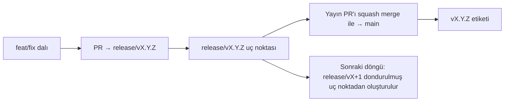

# Branching & Release Model (Türkçe)

🌐 **Languages:** 🇺🇸 [English](../../../../ops/BRANCHING_MODEL.md) · 🇩🇪 [de](../../../de/docs/ops/BRANCHING_MODEL.md) · 🇮🇷 [fa](../../../fa/docs/ops/BRANCHING_MODEL.md)

---

Pusula, **paralel döngü** yayın modelini kullanır: etkin döngü için özel bir `release/vX.Y.Z`
dalı, yayımlanmış hat için `main` ve döngü yayınlandığında değiştirilemez bir
`vX.Y.Z` etiketi. Commit'lerin hem `release/*` dallarına _hem de_
`main` dalına gelmesi beklenen bir durumdur — bir karışıklık değildir.

Bakım sorumlularına yönelik ayrıntılar `CLAUDE.md` (Kesin Kural #21) ve
[RELEASE_CHECKLIST.md](./RELEASE_CHECKLIST.md) dosyalarında yer alır. Bu sayfa,
katkıda bulunanlara yönelik genel özettir.

## Bir bakışta

| Ref               | Rol                                                                                            |
| ----------------- | ---------------------------------------------------------------------------------------------- |
| `release/vX.Y.Z`  | **Etkin döngü** — bu sürüm için günlük geliştirme ve PR birleştirmeleri                        |
| `main`            | **Yayımlanmış hat** — sürüm yayınlandığında döngüyü squash merge yoluyla alır                  |
| `vX.Y.Z` (etiket) | **Yayın işareti** — yayın sırasında oluşturulan, değiştirilemez “yayınlanan içerik” işaretçisi |



## PR'ım hangi dalı hedeflemeli?

**Etkin `release/vX.Y.Z` dalını hedefleyin — `main` dalını değil.**

1. En yüksek açık `release/v*` dalını bulun (bu metnin yazıldığı sıradaki örnek:
   `release/v3.8.49`).
2. Bu dalın uç noktasından yeni bir dal oluşturun (`git fetch` + checkout / bunun üzerine rebase).
3. PR'ı **base = ilgili `release/vX.Y.Z`** olacak şekilde açın.

`main`, günlük entegrasyon dalı değildir. `main` hedef alınarak açılan PR'ların
genellikle birleştirilmeden önce başka bir dalı hedefleyecek şekilde değiştirilmesi gerekir.

## Yayın dondurma (paralel döngüler)

Bir yayın uzlaştırılırken `release-freeze` etiketli bir işaretleyici issue
açılır. Bu, **geliştirmeyi durdurmaz**:

- Dondurulmuş `release/vX.Y.Z`, ilgili yayından sorumlu yayın yöneticisine aittir.
- Katkıda bulunanların çalışmalarını birleştirmeye devam edebilmesi için sonraki döngünün `release/vX+1` dalı dondurulmuş uç noktadan oluşturulur.
- Hâlâ dondurulmuş dalı hedefleyen açık PR'lar, etkin (en yüksek) `release/v*`
  dalını **hedefleyecek şekilde değiştirilmelidir**.

İstediğiniz dalın birleştirilebilir olduğunu varsaymadan önce açık bir dondurma olup olmadığını kontrol edin:

```bash
gh issue list --repo Ferhat-Yasinoglu/pusula --label release-freeze --state open
```

Birleştirme mekanizmaları (sahibin eklediği `queue` etiketi → Mergify)
[MERGE_TRAIN.md](./MERGE_TRAIN.md) belgesinde açıklanmıştır.

## Neden hem dal hem de etiket var?

| Yapı             | Kullanım ömrü    | Amaç                                                                                        |
| ---------------- | ---------------- | ------------------------------------------------------------------------------------------- |
| `release/vX.Y.Z` | Devam eden döngü | İncelenmiş PR'ları toplar, CI testlerini geçer durumda kalır ve PR tabanı olarak kullanılır |
| `vX.Y.Z` etiketi | Sonsuza kadar    | npm / GitHub Releases üzerinde yayımlanan içeriğin tam hâlini işaretler                     |

Dal atölyedir; etiket ise mühürlü pakettir. `main` dalına squash merge yapıldıktan
sonra, önceki yayın PR'ının tamamlanması beklenmeden sonraki döngü `release/vX+1`
üzerinde devam eder.

## İlgili belgeler

- [CONTRIBUTING.md](../../CONTRIBUTING.md) — kurulum, testler, PR kontrol listesi
- [RELEASE_CHECKLIST.md](./RELEASE_CHECKLIST.md) — yayın öncesi doğrulama
- [MERGE_TRAIN.md](./MERGE_TRAIN.md) — birleştirme kuyruğu ve yedek birleştirme treni
- [RELEASE_GREEN.md](./RELEASE_GREEN.md) — yayın uç noktasını sorunsuz durumda tutma
